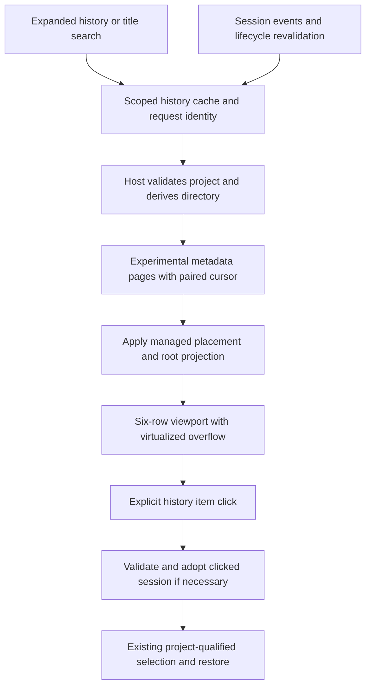

# Worktree Chat History - Plan

## Goal Capsule

- Objective: Let users find and resume earlier conversations directly under the corresponding Agent Manager Local/worktree item without disrupting their current work.
- Means: Independently collapsible, searchable history lists backed by lazy metadata pagination (KTD1-KTD5).
- Authority: Product Requirements govern behavior; Key Technical Decisions govern implementation; unit details override neither.
- Delivery: Implement and verify locally. Do not commit, publish, import another database, or relocate existing sessions as part of this feature.
- Stop conditions: Do not trade complete history access for a fixed data cap, silently open a session in Local when it belongs elsewhere, or bypass project ownership checks.

---

## Product Contract

### Summary

Add nested chat history to both Local and every Git worktree in the Agent Manager project sidebar. Keep each expanded list to six visible history rows, with scrolling, title search, and independent expansion preferences.

### Problem Frame

The sidebar currently exposes execution contexts but not their earlier conversations. Users must navigate through Recent or History elsewhere to resume a chat, losing the relationship between that chat and its worktree.

### Key Decisions

- All conversations in the connected Dustcode database, rather than only Agent Manager-created conversations. Governs R1-R2. (session-settled: user-directed; chosen over managed-only history and external-profile imports.)
- Expand only the restored selected context on first use, then retain independent preferences. Governs R5. (session-settled: user-directed; chosen over initially expanding or collapsing every context.)
- Include on-demand title search within each history. Governs R6. (session-settled: user-directed; chosen over scrolling alone.)

### Requirements

**Membership and Navigation**

- R1. Include all existing root conversations belonging to a context in the connected Dustcode profile/database, regardless of whether their tabs are open or which client created them; exclude subagent conversations.
- R2. Preserve existing explicit Agent Manager placement of a conversation; otherwise associate it with its exact backend directory, not descendant directories or another project. Include archived records consistent with the existing all-session source; deleted records are not history.
- R3. Clicking a history item opens its original project/context/session, reusing its tab if already open and reopening it only on demand otherwise. Preserve drafts and never reassign a conversation as a side effect of selection.

**Presentation and Interaction**

- R4. Render each item as one truncated title plus non-wrapping relative last-updated time, newest first with a stable ID tiebreaker. The list has a maximum viewport of six history-row heights, vertical overflow, and no horizontal overflow; six is not a data limit.
- R5. Provide a disclosure control for Local and each worktree, separate from context selection. Initialize first-use expansion only after authoritative selection restoration; remember subsequent independent choices across Agent Manager reopen, and never override an explicit collapse on selection changes.
- R6. A small search control reveals a title-search input scoped to that history, including matches beyond loaded pages. Search neither transcript contents nor subagent chats; Escape clears the query and hides the input.
- R7. Highlight the current conversation and provide full-title/absolute-time tooltips, visible keyboard focus, accessible disclosure state, and normal keyboard activation. Preserve existing worktree shortcuts, drag/drop, Shift+click pinning, rename, context menus, and health controls.
- R8. Distinguish initial loading, genuinely empty history, no search matches, initial failure, and next-page failure. Offer Refresh/Retry without discarding successfully loaded rows on a next-page error.

**Performance and Freshness**

- R9. History must not block sidebar initialization, context switching, or chat streaming. Load metadata rather than messages, fetch older results only as needed, and keep long lists bounded in rendered DOM work.
- R10. Reflect known session creation/title/update/deletion/placement changes and revalidate on expansion, panel focus, reconnect, or explicit Refresh. Preserve scroll/focus during metadata updates; external processes sharing the database must not require continuous polling.

### Scope Boundaries

- No cross-profile/database imports, cloud-history aggregation, transcript search/indexing, new delete/archive/move actions, or automatic worktree restoration.
- Keep the existing project History action and global sidebar search. The latter is not advertised as an exhaustive search of the new lazy history catalog.
- Do not add a separate backend process, another virtualization dependency, total-count queries, per-row timers, transactional pagination snapshots, or a new configuration setting.
- Do not repair or migrate all existing promotion/move behavior; preserve its effective placement in the history projection instead.

---

## Planning Contract

### Evidence That Shapes the Design

- `packages/kilo-vscode/webview-ui/agent-manager/ProjectSidebarBody.tsx` owns Local and worktree composition. Local is a native button; worktrees are inside a sortable wrapper.
- `packages/kilo-vscode/webview-ui/src/components/chat/WelcomeEmptyState.tsx` provides title/time presentation, but its Recent helper slices to three items. Its Agent Manager selection callback first assigns the chosen chat to the current worktree and must not be reused here.
- `packages/kilo-vscode/webview-ui/agent-manager/project/selection.ts` and `project/restore.ts` resolve worktree placement through managed membership. Unmanaged historical worktree chats need adopt-on-open before selection acknowledgement.
- `packages/kilo-vscode/src/agent-manager/vscode-host.ts` discovers sessions through the normal endpoint, whose default limit is 100. Existing project/session metadata alone cannot establish complete history.
- `packages/kilo-vscode/src/kilo-provider/session-page.ts` already uses the experimental paginated endpoint with directory, root, archive, and title-search filters. Its timestamp-only cursor can skip equal-timestamp records.
- Existing Agent Manager placement overrides can differ from persisted backend `session.directory`; history must not undo those overrides or show the same conversation under both contexts.
- Dustcode uses its own profile/database. Backend SSE is process-local, so another process's writes also require lifecycle-triggered revalidation.
- `virtua/solid` is already installed; `packages/kilo-vscode/webview-ui/diff-viewer/FileTree.tsx` demonstrates a fixed-row list with its own scroll element.

### Key Technical Decisions

- KTD1. **Reuse the experimental endpoint with an additive, tie-safe cursor.** Add optional `cursorID` beside the existing numeric timestamp cursor and a corresponding `x-next-cursor-id` header. Order and continuation use descending `(updated, id)`; retain numeric-only behavior for existing callers. Keep query logic in the Kilo-owned session module and annotate only the necessary shared API/type seams. Regenerate the SDK, rather than editing generated files or adding a parallel endpoint.
- KTD2. **Keep history separate from tabs and managed membership.** A host helper owns metadata discovery, logical placement projection, pagination, and scope validation. Resolve placement from current managed membership first, existing persisted closed-session placement second, and exact backend directory last; explicit Local/null is meaningful. Merge assigned metadata into its destination and exclude it from its former directory. Never bulk-adopt history into tabs or persist a duplicate history catalog.
- KTD3. **Adopt only on explicit open.** The host validates project, context, known-root status, and effective placement, then registers the route and adopts an unmanaged worktree session into that same worktree before the existing project-qualified selection acknowledgement. Do not call the Welcome reassignment callback. This makes existing selection and restoration work without a second navigation model.
- KTD4. **Bound loading and isolate asynchronous state.** Fetch 30 raw metadata rows at a time, deduplicate in-flight requests, and allow at most two concurrent history backend calls. The host owns each scope/query's raw paired cursor, candidate buffer, and generation; the webview requests load-more without manufacturing a logical database cursor. Cache by project/context/directory/query and backend generation; reuse cached rows immediately and revalidate stale data after 30 seconds on R10 triggers. Retain only the unfiltered and current-query cache per context, removing retired-context caches. Debounce title search by 200 ms. Request identities/generations prevent obsolete responses from replacing current results.
- KTD5. **Preserve presentation state outside row mounts.** Keep expansion preferences in the existing project/sidebar persistence flow, with an optional per-context map and an initialization marker. Old state files need no migration. Keep search and history scroll state only for the panel lifetime; pinning, section moves, and project accordion remounts must not reset them. Mount list content only for expanded project/context pairs, and virtualize beyond one page using the existing library. Use one coarse clock for visible relative times, not one timer per row.
- KTD6. **Use existing events, not polling.** Subscribe once at the host/project boundary to relevant session lifecycle metadata and placement changes; coalesce updates rather than rebuilding lists for streamed message parts. Invalidate source and destination on moves. Do not let a pending snapshot overwrite newer lifecycle changes or resurrect deleted sessions. A first-page revalidation starts a new pagination generation rather than appending to an obsolete cursor chain; retain stale rows until a replacement succeeds.

### Data Flow

### Pagination and Placement Rules

- Keep raw backend cursors separate from displayed rows: exclusion of reassigned sessions can leave a raw page empty without reaching the end. Preserve the raw tail before filtering; never advance backend pagination from a remapped display row.
- Merge raw candidates and assigned metadata into a deduplicated host buffer. Hold older assigned-only candidates behind the raw scanned watermark until their chronological position is known, or the raw source is exhausted. Expose sorted safe candidates without skipping unscanned rows.
- Scan at most one raw page per loading turn. If exclusion leaves no safe visible rows, retain loading/continuation and schedule the next bounded turn while expanded, rather than reporting empty or synchronously draining the directory. Collapse/disposal stops further scanning. Sparse reassignment can require extra pages, but must not block the sidebar or other contexts.
- Reuse known managed metadata first; if a reassigned candidate has no metadata, retrieve its session metadata through bounded calls rather than loading its transcript or silently omitting it. Apply the same title-search semantics to assigned candidates.
- Reuse `WorktreeStateManager.closedSessions` as placement evidence after tab closure, not as a reason to exclude history. Preserve placement before removing managed membership; retain those associations beyond the existing 1,000-entry close-record eviction limit until the session/worktree is removed. Do not infer or reconstruct associations already lost before this feature.
- Use the same placement precedence in ordinary `collectProjectSessions()` discovery, SSE projection, new history pages, and route registration. A raw source-directory result must not overwrite a valid explicit assignment; history adoption alone cannot protect against later discovery refreshes.
- Mark roots authoritatively from root-filtered backend results. Preserve the Agent Manager rule that unknown parentage is not proof of a root.
- Derive paths on the host using existing project/path canonicalization; never accept an arbitrary webview-supplied directory. A global session lookup is not ownership authorization: validate root metadata against the authoritative placement and project. Do not guess placement for legacy empty directories. A removed, deleted, or actionably stale target produces a scoped error/recovery affordance, not automatic Local fallback. Indeterminate health alone is not proof the target is stale.

---

## Implementation Units

### U1. Make Existing Metadata Pagination Complete

**Goal:** Supply tie-safe history pages without breaking existing consumers. **Requirements:** R1, R4, R6, R9. **Dependencies:** None.

**Files:** `packages/opencode/src/kilocode/session/index.ts`; minimal seams in `packages/opencode/src/session/session.ts`, `packages/opencode/src/server/routes/instance/httpapi/groups/experimental.ts`, and `handlers/experimental.ts` in that same httpapi directory; regenerated `packages/sdk/js/`; `packages/opencode/test/kilocode/session-list.test.ts`; `packages/opencode/test/server/httpapi-experimental.test.ts`.

**Approach:** Implement KTD1 against the real session database/HTTP route. Emit both continuation headers only when another page exists. Validate the new ID cursor and its timestamp pairing without altering old timestamp-only calls. Keep shared-file changes small and annotated.

**Test Scenarios:**

- More than two pages share one updated timestamp: walking paired cursors returns every ID exactly once in stable order.
- Mixed timestamps, final partial page, empty results, roots, archives, exact directories, and title search retain their expected boundaries.
- Numeric-only callers remain valid; malformed paired cursors fail predictably; final pages omit continuation headers.

**Verification:** Database and HTTP integration tests pass and generated SDK types expose the optional ID cursor.

### U2. Add Scoped Lazy History Retrieval

**Goal:** Retrieve complete context history without making it tab state. **Requirements:** R1-R2, R6, R8-R10. **Dependencies:** U1.

**Files:** New `packages/kilo-vscode/src/agent-manager/history.ts`; existing `packages/kilo-vscode/src/kilo-provider/session-page.ts`; `packages/kilo-vscode/src/agent-manager/project/init.ts`; Agent Manager project message dispatch/lifecycle integration; `packages/kilo-vscode/webview-ui/src/types/messages/agent-manager.ts` and related existing message exports; new `packages/kilo-vscode/tests/unit/agent-manager-history.test.ts`; existing `packages/kilo-vscode/tests/unit/session-page.test.ts` and `agent-project-sessions.test.ts` in that unit-test directory.

**Approach:** Implement KTD2, KTD4, KTD6 and the placement/pagination rules in a testable helper rather than expanding capped provider files. Typed requests/responses carry explicit project/context, query, cache generation, load-more intent, and request identity. Return only row metadata. Reuse `ctx.sessions()` and the existing metadata-only `SessionProvider.getSessionInfo()` for missing assigned candidates; do not use `registerSession()` as a background getter because it changes the current session. Subscribe before initial requests; clean up listeners and pending work on disposal.

**Test Scenarios:**

- Two projects both have Local and similarly named worktrees: pages, queries, caches, and errors never cross scopes.
- A promoted/previously reassigned chat appears only under its effective destination before and after tab closure/panel reopen; its old directory page excludes it, including when several raw pages contain only excluded records.
- Assigned and native-directory candidates interleave across page boundaries without skips, duplicates, premature end-of-list, or a logical cursor advancing past unscanned rows. Sparse pages yield bounded, cancellable scans; missing assigned metadata is fetched without messages.
- A title match beyond the initial 100 sessions is reachable; subagents remain absent and unknown parentage is not promoted to root.
- Rapid query A/B changes, refresh during load-more, collapse/removal/reconnect, and duplicate expand requests respect request generations and the concurrency limit.
- A failed later page retains prior rows and retries the same continuation; a different backend generation does not reuse stale pagination.
- A pending page finishes after a rename, move, or deletion event: stale snapshot data cannot undo the newer event or resurrect the removed row.

**Verification:** Focused helper tests prove membership, complete pagination, request isolation, and zero transcript calls for listing/search.

### U3. Open History Safely and Persist Expansion

**Goal:** Reuse existing selection/restore safely and retain independent disclosure choices. **Requirements:** R3, R5, R7-R8. **Dependencies:** U2.

**Files:** Existing `packages/kilo-vscode/src/agent-manager/project/messages.ts`, `packages/kilo-vscode/src/agent-manager/project/init.ts`, `packages/kilo-vscode/src/agent-manager/WorktreeStateManager.ts`, `packages/kilo-vscode/src/agent-manager/orchestration-setup.ts`, and `packages/kilo-vscode/src/agent-manager/provider-lifecycle.ts`; existing persisted state definitions; `packages/kilo-vscode/webview-ui/agent-manager/project/store.ts` and project persistence integration; `packages/kilo-vscode/tests/unit/agent-project-selection-webview.test.ts`; new `packages/kilo-vscode/tests/unit/agent-manager-history-selection.test.ts`; existing project-store/persistence tests.

**Approach:** Implement KTD3 and expansion persistence from KTD5. Wait for acknowledged selection restoration before first initialization. Persist only preferences and the clicked session's normal managed association, not fetched history. Preserve existing state-before-selection acknowledgement ordering.

**Test Scenarios:**

- From A/Local with a draft, open a closed unmanaged session in B/worktree W: adopt into W, select B/W/session, preserve the draft, and leave backend directory unchanged.
- Repeated clicks reuse an existing tab; switching away/back and reopening Agent Manager restores the selected session in W rather than Local.
- Promote/reassign a chat, close its tab, refresh project discovery, and reopen the panel: the chat stays in W's history and its registered route remains W, including after more than 1,000 later close records. Deleted sessions/worktrees clean up obsolete associations.
- A stale response or deleted/wrong-project/child-session target cannot open or relocate a session.
- With legacy preferences and a restored B/W target, only B/W initially expands after restoration; background project mounts do not seed extra expansions.
- Explicit collapse survives selecting that context, rename/pin/reorder, project accordion remount, and panel reopen. Two projects' Local preferences remain independent.

**Verification:** Existing selection, restore, draft, and persistence tests pass with the new cases; no bulk tab creation or history-driven reassignment occurs.

### U4. Render Accessible Six-Row History Lists

**Goal:** Provide the requested nested navigation without changing worktree controls. **Requirements:** R4-R10. **Dependencies:** U2-U3.

**Files:** New `packages/kilo-vscode/webview-ui/agent-manager/WorktreeHistory.tsx` and a small history state helper if needed; existing `ProjectSidebarBody.tsx`, `WorktreeItem.tsx`, `ProjectList.tsx`, and `agent-manager.css` in that directory; existing webview locale files; new `packages/kilo-vscode/tests/fixtures/worktree-history.tsx` and `packages/kilo-vscode/tests/worktree-history.test.ts`; `packages/kilo-vscode/tests/unit/agent-manager-sidebar-scroll.test.ts`.

**Approach:** Compose the same list under Local and worktrees. Put disclosure/search controls beside, never inside, the Local button; keep history outside worktree drag/click/Shift+click/context-menu activators. Use kilo-ui controls, existing theme tokens, translated labels, `dir="auto"`, and `formatRelativeDate`. Do not reuse Recent's slicing or selection callback. Maintain stable ID-keyed rows and separate nested scroll ownership; keyboard navigation must reach virtualized items.

**Test Scenarios:**

- For 0/1/6/7/many items, at most six complete history rows are visible; older items remain reachable through independent scrolling/pagination.
- Long and Vietnamese/RTL titles truncate without squeezing away the time; tooltips expose complete title/time and active highlighting follows the full scoped identity.
- Search finds unloaded matches, has its own empty/error state, ignores obsolete replies, and Escape restores the unfiltered list without opening a chat.
- Disclosure, search typing, history activation, Retry, and Shift+click/text selection never start dragging or pin/select the parent. Existing header DnD and shortcuts still work.
- Refresh/title updates preserve list scroll and focus; virtualized rows remain keyboard reachable; all controls work in light/dark/high-contrast themes and a narrow sidebar.

**Verification:** Real Solid component/browser fixtures prove geometry, events, focus, and scoping; do not substitute CSS-string/source assertions for interaction tests.

### U5. Verify Integration and Performance

**Goal:** Demonstrate complete history access and responsive navigation under realistic data sizes. **Requirements:** R1-R10. **Dependencies:** U1-U4.

**Files:** `packages/kilo-vscode/webview-ui/src/stories/agent-manager.stories.tsx`; new `packages/kilo-vscode/tests/worktree-history.spec.ts`; `packages/kilo-vscode/tests/accessibility.spec.ts`; extend history unit fixtures as needed; one new `.changeset/` entry for `dustcode` with `minor` intent.

**Approach:** Extend real multi-project sidebar stories and include an integration smoke using the development backend, not the installed production CLI. Rebuild the embedded CLI for extension packaging/smoke; the updated backend, generated SDK, and extension must ship together. Record cold expand, cached reopen, search, and streaming-interaction timings; optimize regressions before calling the feature ready.

**Test Scenarios:**

- A fixture with 200 worktrees and a 5,000-item history issues no additional history requests for collapsed contexts and no transcript requests before a history item is opened.
- Long-history DOM work remains viewport/overscan-bounded rather than proportional to 5,000 rows; cached disclosure and history-row interactions target p95 below 100 ms on the recorded local test machine.
- Rapid expansion/search/context switching while another session streams does not rebuild every history on message-part events or lose focus/scroll.
- Create, rename, close-tab, delete, and existing move actions update the appropriate history; close-tab alone does not remove history. Another process's same-profile write appears after focus/expansion/Refresh.
- An actual older closed conversation beyond the initial discovery limit opens in its owning project/worktree and restores there after reopening Agent Manager.

**Verification:** Measured results and browser smoke support R9; no unbounded DOM, eager history fan-out, new startup dependency, or source-directory routing regression remains.

---

## Verification Contract

Run checks during implementation, not planning. Paths in commands below are relative to the indicated working directory.

| Area | Checks |
|---|---|
| Backend, from `packages/opencode` | `bun run typecheck`; targeted `bun test ./test/kilocode/session-list.test.ts ./test/server/httpapi-experimental.test.ts ./test/server/global-session-list.test.ts` |
| SDK, from repo root | `bun run script/generate.ts`; review generated diff; `bun turbo typecheck --filter=@kilocode/sdk` |
| Extension, from `packages/kilo-vscode` | `bun run typecheck`; `bun run lint`; targeted new history and affected project/session-page/selection/scroll unit tests; real Solid fixture tests |
| Browser/build, from `packages/kilo-vscode` | Rebuild relevant Storybook fixtures; run the new history Playwright spec and affected accessibility cases; `bun run compile` |
| Bundled backend, from `packages/kilo-vscode` | `bun script/local-bin.ts --force` before bundled-backend smoke or VSIX packaging; do not verify against an old installed binary |
| Guards | From repo root: `bun run script/check-opencode-annotations.ts --worktree`; from extension: `bun run check-kilocode-change` and `bun run knip` |

Never run root `bun test`. Respect architecture file-size caps; extract helpers rather than increasing caps. Do not hand-edit generated SDK code. If any URLs change in covered source packages, also run source-link extraction. The optional VS Code self-test harness requires user approval; do not install it automatically.

---

## Definition of Done

- All R1-R10 behavior is implemented and covered by the unit/integration/browser scenarios above.
- U1 preserves shipped cursor callers, U2 proves complete projected history, U3 proves correct open/restore and saved expansion, U4 proves six-row interaction/accessibility, and U5 records performance and real-backend smoke evidence.
- Shared backend edits are minimal and annotated; SDK output and the feature changeset are current.
- No unrelated move migration, external-profile import, abandoned experimental code, generated noise, or changes to existing user edits remain.
- Report exactly which checks passed, failed, or could not run; do not claim the extension ready while introduced type/lint/build failures remain.
