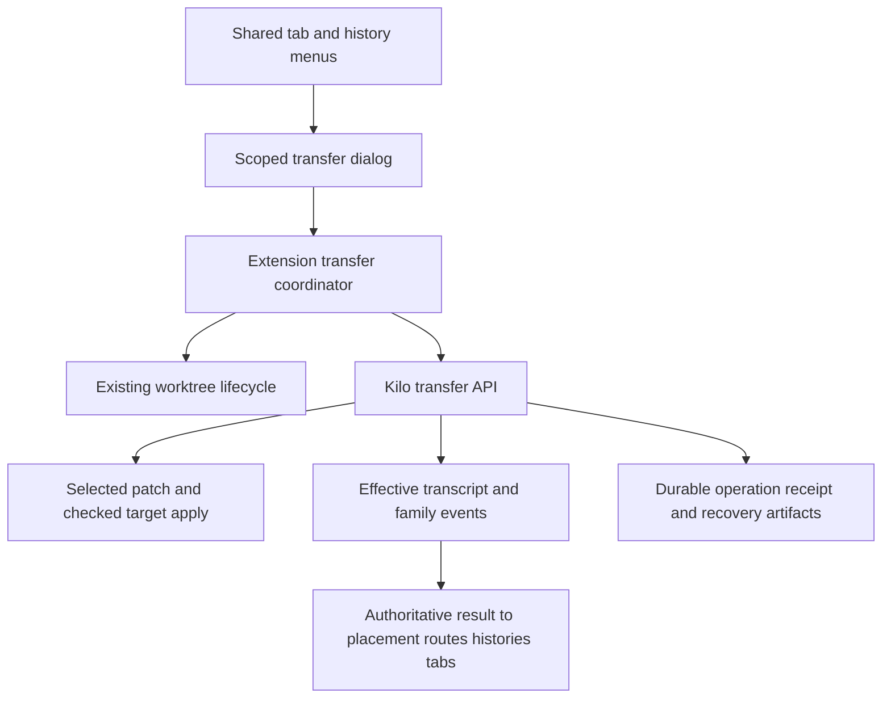
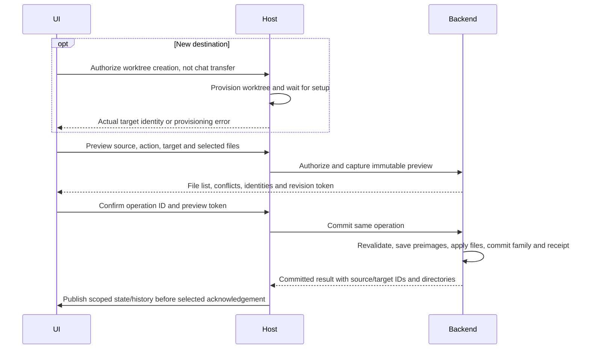
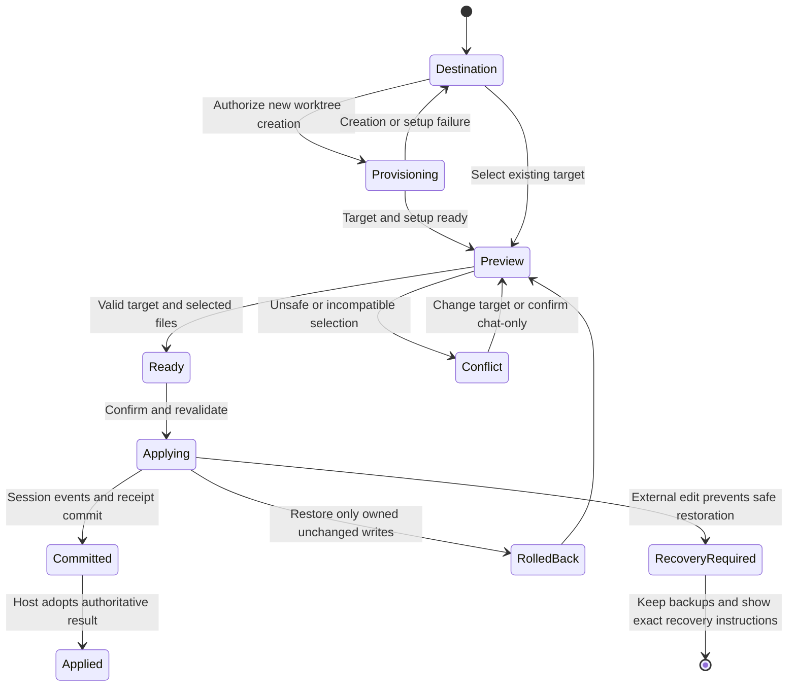

# Move and Copy Chat Sessions to Worktrees

## Goal Capsule

- Let Agent Manager users Move or Copy a root conversation from Local or a worktree into a new or existing worktree in the same registered project.
- Offer optional copying of selected current file changes, without discarding source files or overwriting target changes.
- Move preserves the session ID; Copy creates an independent session. Both execute future tools in the real destination directory and start a fresh file-Undo baseline there.
- This plan extends the current uncommitted history/context-menu feature; it does not replace `.dustcode/plans/1794206196563-worktree-chat-history-plan.md` or authorize reverting its changes.
- Execution is implementation plus local verification. No commit, push, PR, destructive cleanup, or stopping the running backend without separate user authorization.
- Stop rather than weaken ownership, sandbox, rollback, or file-conflict guarantees. Planning performed read-only research; no source edits, tests, builds, or SDK generation were run for this plan.

## Product Contract

### Requirements

- R1. Both chat-tab and history-item menus expose `Move to Worktree` and `Copy to Worktree`, each offering `New Worktree...` and `Existing Worktree...`.
- R2. Support Local-to-worktree and worktree-to-other-worktree within the same registered project/repository. Exclude the current context, Local as a destination, other projects, and unhealthy/missing worktrees. Preserve existing menu behavior outside Agent Manager.
- R3. Move keeps the root session ID and effective conversation, removes its old tab/placement, and opens the same session at the destination. Copy leaves the original unchanged, creates an independent root and required private child sessions, and opens the new root at the destination.
- R4. `Copy selected file changes` is off by default. When enabled, show current staged, unstaged and nonignored untracked changes from the source context, allow file-level selection, and label these as worktree changes, not necessarily changes made by this chat.
- R5. Copy the selected net working-tree changes, including binary content and deletions, as unstaged changes. Preserve source files, source staging, and the target index. Do not copy committed source-branch history into an existing destination.
- R6. Never silently merge, overwrite dirty target paths, leave conflict markers, drop selected files, or partially relocate a conversation after file-copy failure. Offer `Transfer chat only`, `Choose another destination`, or `Cancel` after a conflict; chat-only continuation requires explicit confirmation.
- R7. Copy only the effective conversation at the current Undo/Revert boundary, including retained references to private subagent history. Do not resurrect undone turns. Both operations start new checkpoint/Undo history at the final destination file state; earlier turns remain readable but cannot rewind destination files using source checkpoints.
- R8. Reject deleted, nonroot, unauthorized, remote/workspace-adapter, busy/running/waiting sessions and unsafe destinations on the host/backend, not only in the UI. Do not auto-abort jobs or answer pending input. Recheck before committing.
- R9. Successful transfer updates backend directory ownership, extension placement/routes, tabs, and both histories consistently. Publish state before selection acknowledgement. Failed or cancelled operations do not select/adopt the target or erase source placement.
- R10. A lost response or reconnect must not create a second copy, duplicate applied file changes, or report a committed operation as failed. Interrupted file operations must have explicit, nondestructive recovery.
- R11. Use existing Kilo UI primitives, localization and keyboard/focus patterns. Dialog results are scoped to project, source session, destination and request generation; switching/removing a project or disposing the panel retires obsolete UI responses without losing the operation result.

### Settled Decisions

- D1. Same-project transfers from Local or another worktree, not Local-only or cross-project transfers. Governs R1-R3. (session-settled: user-directed; chosen over Local-only and cross-project scope.)
- D2. Optional selected file copying for both actions, default off; never remove source changes, and copy as unstaged. Governs R4-R6. (session-settled: user-directed; chosen over chat-only and destructive source-file moves.)
- D3. Copy the current effective conversation, not hidden undone history. Governs R3 and R7. (session-settled: user-directed; chosen over copying all stored turns.)
- D4. Move also starts a fresh destination Undo baseline while preserving the session ID and readable conversation. Governs R3 and R7. (session-settled: user-directed; chosen over mapping historical Undo across worktrees.)

### Success Examples

- AE1. A closed Local history session is moved to existing worktree W with file copying off: the same ID disappears from Local history, appears under W, survives restart there, and a subsequent tool resolves W as its working directory.
- AE2. Copy a reverted session to a new worktree: the original stays unchanged, the new root/children have new IDs and remapped references, undone turns stay absent, and old snapshots cannot alter destination files.
- AE3. Select a staged edit, an unstaged deletion, and a binary untracked file: the destination receives their net content unstaged, source content/index stay identical, and unrelated dirty target files stay unchanged.
- AE4. A selected destination path is already dirty or an untracked name collides: no selected file or conversation is transferred; the dialog lists the paths and waits for an explicit choice.
- AE5. The backend commits Copy but its response is lost: retry/status lookup with the same operation ID returns the original copied session rather than creating another one.

### Non-Goals

- Cross-project/repository transfers, remote workspace adapters, Copy/Move to Local, or Copy to the same worktree; ordinary Fork remains available for same-context duplication.
- Automatic conflict resolution, source cleanup/discard, moving terminal processes/notebooks/browser resources, replaying pending work, hunk selection, or copying ignored files.
- Reusing source checkpoints at the destination. Symlinks, hard-linked affected files, submodules and unresolved Git merge states are unsupported for the optional file-copy path and must be identified explicitly, not silently skipped. Chat-only transfer remains available where safe.
- Refactoring general Fork, Continue in Worktree, Apply to Local, worktree lifecycle, or fixing unrelated Windows fixture failures.

## Planning Contract

### Repository Evidence

- `packages/kilo-vscode/src/agent-manager/provider-lifecycle.ts:promoteLifecycleSession` currently changes extension membership/routes but does not relocate the backend session. `project/placement.ts` preserves such legacy overrides, so effective and persisted source directories can differ.
- `packages/core/src/control-plane/move-session.ts` validates backend project identity and publishes `SessionEvent.Moved`. Its `moveChanges:true` applies a patch and then discards source changes, which violates D2. Do not use that flag.
- `packages/core/src/session/projector.ts:263-277` updates the same session table read by legacy `Session.get`, including directory/path/workspace and context epoch. A real Moved event, not a route override, changes tool-routing ownership.
- `packages/opencode/src/kilocode/server/routes/fork-routing.ts` already lets ordinary local Fork enter an explicit target directory. General session routing otherwise prefers persisted session directory over the query directory; a successful global-ID lookup is not ownership proof.
- `packages/opencode/src/kilocode/session/fork.ts` provides batching, transient-part handling and child-reference remapping, but ordinary Fork copies stored undone/checkpoint history. Do not change its existing contract to implement R7.
- `packages/kilo-vscode/src/agent-manager/git-transfer.ts` applies staged changes with `--index`, then unstaged changes, then overwrites untracked paths. It is unsuitable for existing dirty targets and D2 without a separate checked path.
- `packages/core/src/git.ts:729-813` already captures HEAD-to-working-tree binary patches plus nonignored untracked additions and applies a combined patch without modifying the index. Reuse the underlying approach, adding selected-path validation, preview/checking and recovery.
- `packages/opencode/src/kilocode/sandbox/policy.ts` requires confinement inheritance/relocation. Calling same-ID inheritance for Move can reenter a nonreentrant lock; implement a narrow relocation operation instead.
- `packages/core/src/kilocode/event-batch.ts` can publish validated durable events transactionally, including a commit hook. Use it for consistent family changes and a committed transfer receipt.
- `AgentManagerProvider.ts` is near its 1900-line architecture limit. Keep new orchestration in Kilo-owned helpers with dependency injection; do not increase caps.

### Key Technical Decisions

- KTD1. Resolve the registered source/target context using `resolvePlacement` and fresh backend root metadata. Verify canonical worktree roots and shared Git common-directory identity in addition to backend project ID; separate clones can share remote-derived project IDs. No arbitrary target paths from the webview. Implements D1, R2 and R8.
- KTD2. Add one Kilo-owned backend transfer service and thin API for preview, commit and operation-status lookup, shared by Move and Copy. Keep ordinary Fork unchanged and shared upstream router edits minimal/annotated. Use Effect service dependencies rather than adding runtime-backed Promise facades. Implements R3, R7-R10.
- KTD3. The source file directory is the authorized effective extension placement, which may differ from a legacy persisted backend directory. Freeze both identities in the preview and revalidate at commit; do not silently copy files from whichever session directory a generic request happens to choose. Implements D2 and R4-R5.
- KTD4. File selection captures the net HEAD-to-working-tree result plus selected nonignored untracked files. Treat rename source/destination as one selection. Use one binary-safe combined patch, `git apply --check`, then plain `git apply` without `--index`, `--3way`, `--reject` or source discard. Dirty target paths intersecting selected paths are conflicts even if hunks might merge; unrelated dirty paths are allowed. Implements D2 and R4-R6.
- KTD5. Move relocates the root and descendants that share its original execution context, preserving IDs and parent links. Descendants explicitly assigned to another context remain there, with valid references and permissions. Validate the complete relevant family for activity and ownership. Copy clones only child histories reachable from retained effective task references, gives them private IDs at the target, and never resumes source children. Implements R3, R7 and R8.
- KTD6. Build an effective-transcript projection without mutating the Copy source. Honor message/part revert boundaries recursively, remap message/part/task-child/compaction references and copied costs using existing fork conventions, preserve agent/model/permissions, and do not broaden sandbox confinement. For Move, materialize its effective boundary only inside the successful commit. Retire executable old snapshot/patch references and stale cumulative-diff/checkpoint state without deleting shared snapshot objects. Begin a fresh destination epoch/baseline after optional files are applied. Implements D3-D4 and R7.
- KTD7. Use an operation ID, immutable preview fingerprints and a narrow durable transfer receipt with saved target preimages/postimage hashes. The receipt/result and committed ownership revision/context epoch must commit in the same database transaction as the session events. This is required for file/database crash recovery and retry-safe Copy, not a new generic workflow framework. Serialize overlapping transfers and exclude new session work through existing execution/queue ownership mechanisms; recheck source revisions and target state immediately before writes. Implements R6 and R8-R10.
- KTD8. Keep worktree provisioning in the existing extension lifecycle. New targets default to the authorized source HEAD, with the existing naming/setup UX. Mark them as owned by this transfer for safe cleanup and register them only through the normal lifecycle. Do not run an auto-started setup that can mutate selected target paths concurrently with commit; wait for setup to settle and fingerprint afterward. Implements R2, R4 and R9.

### High-Level Technical Design

These sketches establish boundaries and invariants, not exact helper names or framework signatures.

| Mode | Conversation identity | Source conversation | File behavior |
|---|---|---|---|
| Move, chat only | Same IDs for moved members | Rehomed, not duplicated | No user-file writes |
| Copy, chat only | New root/private child IDs | Unchanged | No user-file writes |
| Move with files | Same IDs for moved members | Rehomed after successful file apply | Selected net changes copied; source unchanged |
| Copy with files | New root/private child IDs | Unchanged | Selected net changes copied; source unchanged |

### Failure and Recovery Rules

- Previews have no session/user-file side effects. New Worktree uses two explicit stages: authorize creation after validating source/name, show provisioning/setup progress and failures, then preview the actual target and enable final Move/Copy confirmation. Creation authorization is not transfer confirmation. Fingerprint after provisioning/setup and stop on changed source HEAD/revision rather than silently recapturing different content; cancellation follows owned-worktree cleanup rules.
- Retain immutable selected source bytes and target preimages before applying. Enforce safe relative paths and directory boundaries; reject path traversal, symlink ancestors, hardlinks and case-colliding names. Use literal pathspecs/argument arrays, not shell interpolation. Windows path and file-lock errors must be surfaced explicitly.
- The optional file path fails closed on unreadable, oversized or unsupported selected files. Reuse existing payload limits where applicable, show the reason in preview, and never log raw file/patch content. Keep private recovery artifacts outside the repository.
- Save target HEAD/index identity and fingerprints for touched paths. Recheck them immediately before apply. Git conflict checking is not an atomic transaction with the database or external editors; save and verify postimages and use the receipt to resolve uncertain outcomes.
- If failure occurs before session commit, restore only the operation's touched paths whose current state still matches its own postimage and whose recorded target HEAD/index identity is unchanged. Compare semantic index entries, not stat-only index refresh. If an external edit, staging or commit blocks restoration, retain backups, identify affected paths, and show `Recovery required`; do not claim full rollback or overwrite newer data. Preserve the target index and unrelated files.
- On restart/retry, reconcile the receipt with committed session events/result before applying or rolling back. For a committed result, fetch current backend ownership and compare its context epoch/revision before idempotent host adoption. A later Move or deletion supersedes the old placement: record the earlier operation as completed without restoring its obsolete route/tab or resurrecting a deleted session. An uncommitted operation restores only safe owned writes. Never replay a patch on a committed operation.
- If a newly provisioned worktree is unused, unchanged and still owned by this operation, reuse existing safe cleanup. Otherwise retain it visibly for recovery. Never delete an existing target, unrelated branch, or any unexpected data.
- Once commit starts, closing the dialog/panel stops UI observation, not the underlying durable operation. Cancellation is effective before writes; later recovery/status is explicit. Old project generations must not select/adopt a result into another project, but its receipt stays discoverable.

## Implementation Units

Execution note: add focused failing regressions before each behavior change, then run its smallest relevant checks. New proposed files below are seams, not a requirement to split every helper. Keep source helpers cohesive and architecture caps unchanged.

### U1. Define authorized transfer preview and operation boundary

- Requirements: R2, R8, R10-R11; KTD1-KTD3 and KTD7.
- Add shared extension/webview transfer contracts and the Kilo backend preview/commit/status contract. Carry action, project/context source IDs, explicit authorized directories, operation ID, destination identity, revision token and selected relative paths; return structured conflict/stale/busy/unauthorized/recovery errors and authoritative metadata.
- Implement canonical repository/worktree checks, root validation, family membership and activity preflight. Reject absent/removed/imported-invalid targets, same-context targets, separate clones with the same remote, remote adapters and forged paths. Preview must not route-register, adopt a history session, or load transcripts into the webview.
- Files: proposed `packages/kilo-vscode/src/shared/session-transfer.ts`; Kilo-owned transfer service/HTTP group/handler under `packages/opencode/src/kilocode/`; minimal group registration and matching message-union exports.
- Tests: same repo linked worktrees accepted; different clone/project/path escapes rejected; closed history sources with legacy placement mismatch resolved correctly; eligible root sources accepted; nonroot/deleted sources and busy/running/waiting sources or relevant descendants rejected; stale preview/removed target blocked at commit.

### U2. Add selected-change capture, checked apply and durable recovery

- Depends on U1. Requirements: R4-R6 and R10; D2, KTD3-KTD4 and KTD7.
- Build the selected net binary patch without touching the source index. Support ordinary files, additions, deletions, binary changes and coupled renames; explicitly disable unsupported selections. Add private preimages/fingerprints and a narrow durable receipt/result record, with an additive schema migration only if required for atomic result storage.
- Preflight conflicts against selected target paths, preserve unrelated dirty paths and target index, and apply as a single unstaged operation. Add conditional rollback and interrupted-operation status/recovery; do not call the existing untracked-overwriting extension apply helper or `moveChanges:true`.
- Tests using real temporary Git worktrees: mixed staged/unstaged edits of one file collapse to final net content; binary/untracked/deleted/renamed files; dirty unrelated target paths preserved; dirty selected paths/name collisions fail without writes; source/index byte equality; Unicode/spaces/Windows separators and case collisions; unsupported links/submodules; apply failure, external edit during rollback, staging/committing applied bytes before recovery, restart after file apply, and repeat operation IDs.

### U3. Implement real Move and independent effective Copy

- Depends on U1-U2. Requirements: R3 and R7-R10; D1-D4, KTD5-KTD7.
- Move publishes backend relocation for the defined family, updates context epochs and sandbox confinement, and preserves IDs/parent links. Do not reenter same-session sandbox inheritance locks. Keep explicitly different-context descendants in place.
- Copy stages a complete projected root/child family with remapped IDs/references, source agent/model/permissions and safe sandbox inheritance. Keep ordinary Fork unchanged. Do not copy undone history, scheduled/live execution state, source share identity, source revert markers or executable historical checkpoint references.
- Publish staged session changes and the committed receipt atomically after successful optional file application; initialize a fresh destination baseline. Before commit, failure must not expose a half-created copy or a half-relocated family. A commit result must be retrievable after response loss.
- Tests: backend `session.get.directory` and the next tool request use the destination; Move root/eligible descendants preserve IDs and cross-context children stay valid; Copy source remains byte-for-byte unchanged; message/part revert boundaries, child refs, compaction refs and costs; permissions/sandbox not broadened; baseline Undo cannot touch source files; failure halfway through family publication rolls back; retry returns the same copied ID.

### U4. Coordinate extension placement, worktrees and history atomically from the user's view

- Depends on U3. Requirements: R1-R3 and R8-R11; D1-D2, KTD1 and KTD8.
- Add a dedicated host transfer coordinator with project generation/disposal checks and injected lifecycle/session dependencies. Route both new and existing targets through this path; replace Agent Manager's current promote-only shortcut without modifying unrelated continuation/apply flows.
- New worktrees use source HEAD and existing name/setup lifecycle. Existing targets are revalidated from state plus disk/Git identity at confirmation. Keep backend commit authoritative; update managed/closed placement, exact routes, pins/tab order and old/new history caches only afterward.
- Move removes source placement and transfers its applicable tab pin to the target context. Copy leaves source tabs/pins untouched and opens one unpinned target tab. Selecting an already closed source for transfer adopts only the successful result, never a temporary source tab.
- Publish state/history changes before activating the target and acknowledge once. Reconcile result receipts on reconnect against fresh backend ownership/epoch, not only the receipt's original destination; obsolete UI generations cannot steal focus or restore superseded placement. Cancel/failure retains the source and does not fall back to Local.
- Files: proposed host `src/agent-manager/session-transfer.ts`; existing `provider-lifecycle.ts`, `fork-session.ts` seams, `WorktreeStateManager.ts`, `project/placement.ts`, history invalidation/wiring and minimal Provider dispatch. Do not increase Provider/architecture caps.
- Tests: all four action/target combinations from open and closed history in active/background projects; legacy persisted-directory mismatch; same root adopted once; response loss/reconnect; an A-to-B result replayed after another client's B-to-C Move or deletion; project removal/disposal; new-target cleanup ownership; pin/order/history state preserved on success and unchanged on failure.

### U5. Add shared Move/Copy target and optional-files UI

- Depends on U1 contracts and U4 integration. Requirements: R1-R7, R8 and R11; D1-D4.
- Extend the shared `SessionTabMenu` with optional transfer submenus; wire Agent Manager's `SortableTab`/tab rendering and `HistorySessionMenu` to the same scoped request, not separate implementations. Keep generic sidebar menu consumers unchanged unless they provide these capabilities.
- Add one controlled transfer dialog using Kilo UI components. Include action/source, new/existing destination choice, searchable healthy worktree list with branch/path, optional selected-file list and the new Undo-baseline notice. For new targets reuse existing branch/worktree naming validation and source-HEAD display.
- New Worktree first exposes `Create Worktree` authorization and a provisioning/setup progress state. Only after the target is ready and its preview is valid does the dialog expose final Move/Copy confirmation; handle provisioning failure and cancellation without transferring a conversation. An empty existing-target list or no search matches offers the new-target path, never an implicit fallback.
- Clear file-selection/preview tokens when source, destination or action changes. Disable confirmation while preview is stale/loading or an operation is committing. On conflict list paths and show the three explicit R6 choices; do not silently downgrade to chat-only. Keep errors/retry/status in the same scoped dialog.
- Restore focus to the invoking tab/history row on cancellation, and to the destination chat on success. Prevent right-click, submenu keyboard events and dialog interactions from triggering parent worktree selection/drag/pinning. Use localized strings and project-scoped identity throughout.
- Tests in real Solid/Chromium fixtures: right-click and Shift+F10, both submenus, new/existing worktree search, creation-authorization/provisioning/preview/final-confirmation ordering, empty targets/search, Local/worktree source, no premature open/adoption, busy-state changes, file checkbox/selection, stale responses, conflict alternatives, Escape/focus, success navigation, scroll and virtualization regression. Add representative Storybook/a11y cases; no CSS/source-string assertions as UI proof.

### U6. Verify real transfer, migration and restart behavior

- Depends on U1-U5. Requirements: R1-R11.
- Extend the development-backend integration smoke with disposable databases and real Git worktrees; never use the production backend/profile to test mutations. Exercise all eight combinations of Move/Copy, new/existing, chat-only/selected-files, including an older closed history source beyond discovery limits.
- Prove actual destination execution with a harmless tool/API probe, not just extension metadata. Record unchanged source/index hashes and preserved unrelated target changes. Inject failure at file apply, family commit and response delivery; restart/reconcile receipts and verify exactly one root copy and no partial family.
- Add a concise user-facing changeset for the extension and any externally exposed backend feature. Regenerate SDK/OpenAPI through the repository generator after endpoints change, never edit generated code by hand. Existing sessions need no eager relocation/backfill; legacy placements are handled only for an explicitly confirmed transfer.

## Verification Contract

| Area | Required checks/evidence |
|---|---|
| Backend helpers/API | Package-scoped targeted tests under `packages/opencode/test/kilocode/`, actual Git/database/HTTP fixtures, `bun run typecheck` from `packages/opencode` |
| Core event/sandbox seams if touched | Focused package tests for transactional relocation/family confinement plus package typecheck; preserve Effect service patterns |
| Extension host/UI | From `packages/kilo-vscode`: `bun run typecheck`, `bun run lint`, targeted unit tests, real transfer/history browser fixtures and a11y cases |
| Integration build | From `packages/kilo-vscode`: `bun run build:check`, `bun run compile` when the bundled executable can be replaced; report Windows executable locks and do not stop active sessions to clear them |
| Generated API | Root `bun run script/generate.ts`; SDK typecheck and generated-diff inspection |
| Local guards | `bun run knip`, `bun run check-kilocode-change` from extension; root `bun run script/check-opencode-annotations.ts --worktree`; Promise facade guard if touching service adapters; source-link extraction if URLs change; `git diff --check` |
| End-to-end | Isolated `bun dev serve`, actual SDK transfer calls, real tool-directory proof, Git content/index assertions, receipt replay across backend and panel restart |

Run package tests, never root `bun test`. Preserve the pre-existing dirty worktree, including `.dustcode/kilo.jsonc`, earlier plans and the current history/menu implementation. Do not treat pre-existing Windows fixture failures or a locked running `bin/kilo.exe` as permission to weaken checks; report exact residual failures separately.

## Definition of Done

- R1-R11 and AE1-AE5 are covered by implementation and executable evidence.
- Move changes the real backend directory with stable session identity; Copy creates one independent effective conversation at the destination.
- Selected files are copied unstaged only after confirmation; source/index and unrelated target data remain unchanged, and conflicts do not leave partial session changes.
- New baseline, family references, sandbox confinement, idempotent retries and interrupted-operation recovery are tested, including failure paths.
- Tab and history menus share the flow, work across active/background same-project contexts, and remain keyboard accessible without changing ordinary Fork behavior.
- Additive receipts/migrations and SDK artifacts are included when needed; no speculative global refactor, destructive cleanup, silent source-directory fallback or source-file discard is introduced.
- Relevant checks pass or exact external/pre-existing blockers are reported; changes remain local and uncommitted unless separately requested.

## Open Questions

None blocking. Product choices D1-D4 are settled. Unsupported optional file types are explicit non-goals, not permission to skip selected content silently.

## Appendix

- Git apply reference: https://git-scm.com/docs/git-apply. `--check` validates applicability; plain apply fails on conflicting hunks without `--reject`; `--index`/`--3way` affect the index and are not appropriate for the settled unstaged-copy contract. Git patch checks do not replace cross-resource rollback or crash recovery.
- Existing focused tests to extend include `tests/unit/agent-manager-provider-lifecycle.test.ts`, `agent-manager-promotion-handoff.test.ts`, `agent-manager-continue-in-worktree.test.ts`, `agent-manager-history-selection.test.ts`, `agent-manager-history.test.ts`, and `tests/worktree-history.test.ts` in `packages/kilo-vscode`; use Kilo-owned backend transfer/fork/sandbox test homes for new backend coverage.
