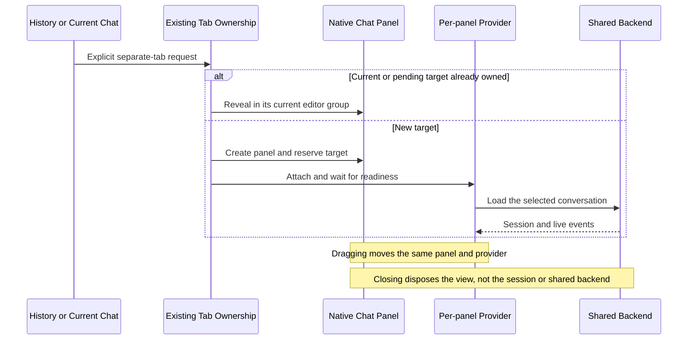

# Multiple Chat Session Tabs - Plan

## Goal Capsule

- Objective: Let users work on several conversations at once and arrange them side by side without losing their current work.
- Means: Extend the existing native VS Code chat editor panels, not an embedded tab or split-layout system.
- Authority: Product Requirements govern behavior; Key Technical Decisions govern implementation; implementation units override neither.
- Delivery: Implement and verify locally after plan approval. Do not commit, publish, install optional QA tooling, or launch a separate application window without authorization.
- Stop conditions: Do not replace another tab's conversation, route an action to the wrong session, create a backend per tab, or modify unrelated worktree changes.

---

## Product Contract

### Summary

Add explicit actions to open an existing conversation in its own editor tab while preserving normal in-place history navigation.
Users can open several conversations, drag native tabs into split editor groups, and resume each tab's own conversation after reloading VS Code.

### Problem Frame

The extension already creates multiple chat editor panels through `dustcode.openInTab`, but that alone does not establish a reliable existing-session-to-tab workflow.
Users need to keep one conversation available while opening another and arranging both beside their code.

### Key Decisions

- Native editor tabs rather than separate VS Code application windows or a split layout inside Agent Manager. Governs R1, R3. (session-settled: user-directed; chosen over separate application windows and an embedded multi-chat page.)
- Explicit separate-tab actions rather than changing ordinary history clicks. Governs R2. (session-settled: user-directed; chosen over always opening history selections in a new tab.)
- Native tab drag-and-drop rather than custom webview drag handles. Governs R3. (session-settled: user-directed; chosen over an embedded tab/split system.)

### Requirements

**Opening and Navigation**

- R1. Support multiple independent native chat editor tabs in one VS Code window, including the existing ability to create a new empty chat tab.
- R2. Provide an accessible "Open in Separate Tab" action for a history entry and the current conversation; ordinary history selection keeps its existing in-place behavior.
- R3. Allow dragging a chat tab onto a native editor split target or between editor groups without replacing its session, losing its draft, or interrupting its live updates.
- R4. The separate-tab action reveals an existing editor tab for the conversation in its current group, including repeated requests while its initial load is pending; ordinary in-place navigation is unchanged.

**Session Isolation and Lifecycle**

- R5. Each tab displays and acts on its own conversation: sending, stopping, permissions, questions, titles, and current-session commands must not target another tab's session.
- R6. Closing a chat tab releases that view's resources without deleting or aborting its backend conversation or disposing the shared backend connection.
- R7. Reloading or reopening VS Code restores each saved tab to its own conversation and existing execution context, rather than the last session selected by another surface.
- R8. A failed open or unavailable restore target produces a visible recoverable error or empty state, never a silent substitution of an unrelated session.

### Scope Boundaries

- Limit new entry points to the ordinary sidebar/editor chat surfaces. Preserve Agent Manager behavior and project/worktree ownership.
- No separate application windows, custom split-layout framework, automatic worktree creation, new backend endpoints, or backend-per-tab processes.
- Do not promise uninterrupted backend execution across a full VS Code restart; R7 restores the conversation, not a terminated process.
- Preserve existing draft persistence semantics. R3 requires draft retention during native moves; this feature does not add cross-surface draft synchronization or durable storage for every attachment.
- Considered and not built: a duplicate-view/clone command. Separate-tab requests reuse an existing matching panel; native dragging moves that panel. Ordinary in-place navigation remains unchanged and may leave multiple surfaces displaying the same conversation.
- Considered and not built: tab-count limits, polling, a new settings toggle, or a general surface-routing rewrite. No requirement needs these mechanisms.

### Acceptance Examples

- AE1. Covers R1-R3, R5. With conversation A and an unsent draft open, open B from History using the separate-tab action and drag B to a right-hand editor split; A and B remain usable independently and A's draft stays intact.
- AE2. Covers R4. Open B again from History before its initial load finishes or after it has moved to another editor group; reveal the same panel without moving it back or creating a duplicate.
- AE3. Covers R6. Close A while A is running and B remains visible; B continues working and reopening A reconnects to its conversation without an implicit stop/delete operation.
- AE4. Covers R7-R8. Reload with A and B open; restore A and B to their respective tabs. If B is unavailable, B reports that problem instead of displaying A.

---

## Planning Contract

### Established Constraints

- Reuse `packages/kilo-vscode/src/extension.ts`: the existing panel map, per-panel `KiloProvider` attachment, and `dustcode.TabPanel` serializer are extension points, not a system to replace.
- Keep one shared `KiloConnectionService` per extension host and existing per-provider session event filtering.
- Preserve unrelated modifications in `packages/kilo-vscode/src/kilo-provider/native-tab-title.ts` and `packages/kilo-vscode/tests/unit/native-tab-title.test.ts`.
- Follow `packages/kilo-vscode/AGENTS.md`, SolidJS provider composition, kilo-ui controls, existing message contracts, and `dustcode.` command/view naming.
- Native `WebviewPanel` dragging moves one panel between editor columns. `onDidChangeViewState` is also a movement/visibility event, not solely a focus event.
- Hidden-context retention is not restart persistence. Each panel needs its own JSON-serializable state and serializer restoration path.

### Key Technical Decisions

- KTD1. **Extend the existing panel map and attachment path.** Keep `dustcode.TabPanel`, shared connection ownership, per-panel providers, and native hidden-context retention. Delegate drag/split geometry to VS Code and do not reset webview HTML or session selection on movement.
- KTD2. **Track selected and pending sessions before asynchronous loading.** The provider's fetched `currentSession` can lag its selected `contextSessionID`; explicit open deduplication must use current selection plus any pending reservation, not the fetched-session getter alone. Match the session's resolved execution context, not the mutable workspace selection. If ordinary navigation leaves several matching panels, prefer the last-focused matching panel and otherwise an existing match; never create another. Later user navigation wins: invalidate pending claims on navigation, new-task, or disposal and recheck ownership after readiness/load awaits. Disposal resolves the existing readiness wait, so readiness alone is not proof the panel is live.
- KTD3. **Reuse panel-owned persistence rather than add a second tab store.** `LocalTabsProvider` already persists `sidebarSessionTabIDs` and `sidebarActiveSessionTabID` through the webview state API. Reconcile serializer initialization with that existing restore flow, preserve legacy missing-state behavior, and never let an unavailable explicit restore target silently select an unrelated saved session.
- KTD4. **Keep draft ownership where it is.** Existing module-local draft maps remain owned by each webview; native movement retains that webview. Opening the same conversation from another surface does not transfer or synchronize its draft.
- KTD5. **Target concrete providers across editor groups.** `panel.active` is per editor group, so taking the first active panel from the map is insufficient. Reuse the existing concrete last-focused `chat` provider and `onFocused` callback for current-session commands; bind surface-originated history/new/open actions to their source provider. Visibility or move events must not retarget commands to another visible panel. Avoid a generic focus-routing rewrite.

### High-Level Technical Design

### Sources

- `packages/kilo-vscode/AGENTS.md`.
- `packages/kilo-vscode/src/extension.ts`, especially panel attachment, serialization, and `openKiloInNewTab`.
- `packages/kilo-vscode/src/KiloProvider.ts`: selected versus fetched session identity, readiness, message dispatch, and view-only disposal.
- `packages/kilo-vscode/webview-ui/src/context/local-tabs.tsx` and `webview-ui/src/utils/local-tabs.ts`: panel-owned persistence, debounced saves, restoration, and missing-session fallback.
- [VS Code Webview API: Visibility and Moving](https://code.visualstudio.com/api/extension-guides/webview#visibility-and-moving).
- [VS Code Webview API: Persistence and Serialization](https://code.visualstudio.com/api/extension-guides/webview#persistence).

---

## Implementation Units

### U1. Open or Reveal a Targeted Native Chat Tab

**Goal:** Extend the native panel path to open a requested conversation and reuse an existing owner. **Requirements:** R1, R4-R6, R8. **Dependencies:** None.

**Boundaries:** `packages/kilo-vscode/src/extension.ts`; the existing provider's session-selection/readiness interface; one small Kilo-owned tab helper only if needed to test the ownership logic without loading the whole extension.

1. Keep the existing no-argument new-chat command behavior. Add a typed existing-session open path and callback shared by the two new UI entry points.
2. Resolve the conversation through the existing trusted session/context APIs; do not trust an arbitrary webview-supplied working directory or move a session between projects.
3. Look up the selected or pending target before creating a panel. Reserve new ownership synchronously, reveal an existing panel in its actual current column, and clear obsolete ownership when that panel navigates or is disposed.
4. Attach through the existing factory, wait for readiness, and load only if the panel and target still match. Invalidate pending claims on later navigation, new-task, or disposal; late loads and late errors must not replace a newer selection or steal focus. Reuse existing transcript cancellation rather than duplicating it.
5. Keep ordinary in-place history navigation intact. Deduplication is for separate-tab requests, not a new global rule that redirects every selection.

**Tests:** Extend `tests/unit/kilo-provider-open-session.test.ts`, `kilo-provider-load-messages.test.ts`, and `kilo-provider-route-integration.test.ts` under `packages/kilo-vscode/`; add a focused native-session-tabs ownership test if a helper is introduced. Cover separate blank panels; repeated and concurrent opens; a panel moving groups before reveal; navigation while load is pending; errors followed by retry; disposal during readiness/load; and release of an old session mapping after ordinary in-place navigation. Use the real ownership implementation with thin VS Code boundary fakes, not copied test logic.

### U2. Expose Separate-Tab Actions Without Changing History Clicks

**Goal:** Make U1 reachable from the ordinary chat UI. **Requirements:** R2-R4, R8. **Dependencies:** U1.

**Boundaries:** Existing history-row actions, current-chat toolbar/menu, typed webview messages and host dispatch, and existing locale files. Keep Agent Manager entry points unchanged.

1. Add a labelled icon action/menu item for a history entry. Prevent that action from also triggering the row's existing in-place selection.
2. Add the current-chat action alongside existing session actions. Resolve the selected session even while its messages are loading; disable the action when no backend session exists rather than copying a placeholder ID.
3. Use existing kilo-ui buttons/menus, translations, tooltips, and keyboard focus conventions. Keep actions usable in narrow native editor splits without adding new layout dependencies.
4. Show the existing loading/error affordances for the target panel. Opening a separate tab must not navigate or clear the source surface or its draft.

**Tests:** Extend `packages/kilo-vscode/tests/history-accessibility.spec.ts` for row actions and nearest existing host-message tests. Verify ordinary click still selects in place; separate-tab action emits exactly one typed request; keyboard activation works; placeholder/no-session state is disabled; source drafts remain unchanged; errors can be retried; and Agent Manager does not gain duplicate actions.

### U3. Restore Per-Panel Identity and Verify Split Isolation

**Goal:** Preserve each tab's session across native movement and window restoration. **Requirements:** R3-R8. **Dependencies:** U1-U2.

**Boundaries:** Existing `dustcode.TabPanel` serializer, provider initialization, `LocalTabsProvider` state restoration, panel focus/disposal wiring, and the extension's existing unit/webview test harnesses.

1. Read and validate existing per-webview state before target-sensitive initialization; restore only that panel's saved active conversation through the existing restore mechanism. Avoid parallel host and webview restore requests racing for different sessions.
2. Keep persisted state JSON-serializable, panel-local, and metadata-only. Reuse existing keys, preserving unrelated webview state. Commit a native tab's accepted session selection without waiting for the existing 300 ms debounce, so an immediate reload does not restore the previous session; handle old missing-state shapes without a database migration or new workspace-global current-session key.
3. Reserve restored ownership while initialization is pending. The existing local-tab normalization/pruning can choose the first surviving saved ID; do not apply that fallback to an unavailable explicit native restore target. Report that target's failure visibly, clear its reservation, and let the user choose recovery.
4. Audit move/visibility/focus events and commands in two editor groups, including two panels with `active === true`. Use the existing concrete last-focused provider rather than map order, and source-bind sidebar title actions. Preserve the same provider and webview on movement, with session-filtered live events, permissions, stop actions, and titles.
5. Verify disposal detaches only the view/provider resources. Do not issue backend abort/delete calls or dispose the shared connection on tab closure.

**Tests:** Extend `packages/kilo-vscode/tests/unit/close-task-target.test.ts` and existing local-tab restore tests. Add `packages/kilo-vscode/src/test/native-session-tabs.test.ts` for real extension-host panel/group behavior where automatable. Restore A and B from different panel states, including reload during initial selection; active saved session missing/deleted; legacy state without these keys; tab movement during streaming with an unsent draft; commands/permissions targeting the focused tab; and closing A while B and the shared backend remain usable. Agent Manager tab-drag tests are not proof of native editor movement.

---

## Verification Contract

| Requirement | Proof |
|---|---|
| R1, R4 | Real tab-ownership unit tests for independent blank tabs, existing/pending session deduplication, movement, retry, and stale async work |
| R2, R8 | Typed host-message and webview interaction tests for both actions, unchanged normal clicks, disabled placeholders, and recoverable errors |
| R3, R5 | Two native editor groups with different sessions: drag/drop, drafts, concurrent live updates, stop, permissions, titles, and focused commands |
| R6 | Disposal tests plus a live close/reopen scenario showing no implicit backend abort/delete/shared-service disposal |
| R7-R8 | Per-webview state/serializer tests and a real window reload with two distinct saved sessions and an unavailable-target case |

- From `packages/kilo-vscode/`, run `bun run typecheck`, `bun run lint`, focused unit tests for changed modules, `bun run test:unit`, and `bun run compile` for the host/webview message integration.
- Run affected extension guards: `bun run check-kilocode-change` and `bun run knip`. Do not add `kilocode_change` markers in Kilo-owned extension files.
- Execute AE1-AE4 in the development extension host. Browser-only webview tests cannot prove native editor dragging, view columns, or window restoration; label missing host coverage explicitly.
- Do not run root `bun test`. Source-link extraction is needed only if implementation adds or changes URLs in guarded source paths.
- Add one concise minor changeset for `dustcode`, the name in this fork's `packages/kilo-vscode/package.json`, describing independent chat tabs and native split support. No changeset or source files are written during this planning run.
- Optional QA: offer the shared VS Code self-test harness before installing or using it; it is not a prerequisite and must not be installed without the user's choice.

## Rollout and Migration

- Ship through the existing extension commands and webview bundle. Existing history clicks, new-blank-tab commands, backend services, and Agent Manager remain compatible.
- Use existing per-webview state with tolerant handling of missing legacy fields; no backend/database migration or new feature flag is required.
- Roll back by removing the new actions and targeted-open wiring. Existing conversations remain in the backend and are not deleted with panel state.

## Definition of Done

- Both explicit actions open or reveal the correct native editor tab without replacing the source conversation or losing its draft.
- Native drag/split, per-session action isolation, close/reopen, pending-open deduplication, and per-tab reload restoration satisfy AE1-AE4.
- Required checks pass, or any blocked check is named precisely; native editor scenarios are not represented as proven by webview-only tests.
- Only intended feature files and the release changeset change during implementation; existing unrelated native-title edits are preserved.

## Planning Review

- Coherence, feasibility, design, scope, and adversarial reviews completed. Corrected the global-dedup ambiguity, removed unrelated notification-routing changes, and selected the actual `dustcode` release package; no unresolved product decisions or launch blockers remain.
- The final feasibility follow-up reported no findings. Native editor behavior and the listed checks remain implementation-time validation, not tests claimed to have passed during planning.
- Only this plan was written. Existing source edits and staged changes were left untouched.
