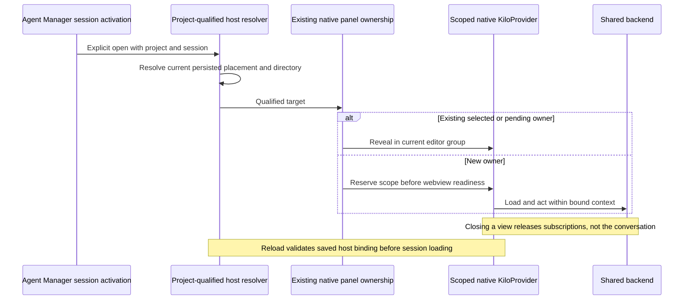
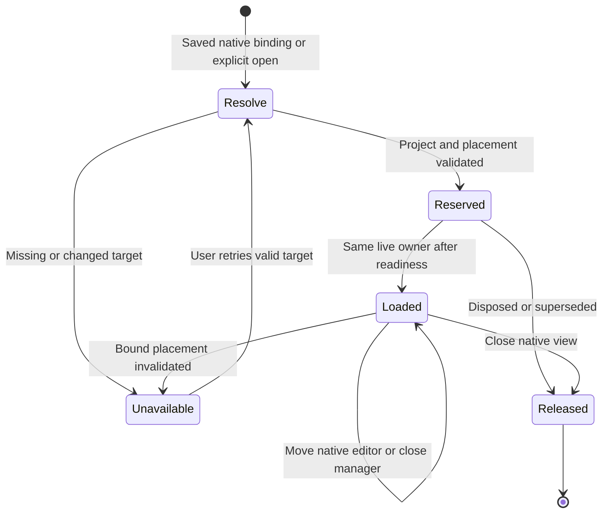

# Agent Manager Native Chat Tabs - Plan

## Goal Capsule

- Objective: Work on Agent Manager conversations side by side with code and with other worktree conversations in one VS Code window.
- Means: Open Agent Manager conversations through the existing native chat editor panels; use VS Code's native tab movement and split targets.
- Authority: Product requirements govern behavior; technical decisions govern implementation within those requirements.
- Delivery: Implement and verify locally. Preserve existing uncommitted work; do not commit, publish, install extensions, reload windows, or launch additional application windows without authorization.
- Stop conditions: Never substitute another project/worktree, duplicate a backend session or initial prompt, or abort a session still attached to a native chat by closing a view.

---

## Product Contract

### Summary

Clicking a chat session in Agent Manager opens or reveals that conversation as a native VS Code editor tab, for both local and worktree sessions.
The native tab contains the conversation; Agent Manager retains worktree management, Run, Apply, and its terminal interface.

### Problem Frame

The current native-tab implementation serves ordinary sidebar/editor chat, while Agent Manager still opens conversations inside its own webview.
Its internal session tabs are not native editor tabs and cannot be dragged onto VS Code editor split targets.
The user wants to open Agent Manager chats directly from its session list and arrange the resulting editor tabs beside code or other chats.

### Key Decisions

- **Default session activation opens a native tab**, rather than requiring a separate icon action. Governs R1, R2. (session-settled: user-directed; chosen over preserving embedded-only clicks and adding an optional separate-tab button.)
- **Chat-only native tabs**, not another complete Agent Manager instance. Governs R3, R4. The user selected the native editor-chat workflow after the distinction was explained.

### Requirements

**Opening and Management**

- R1. Explicitly opening an existing chat from Agent Manager's session tabs, local-session entries, or nested local/worktree history opens or reveals its native editor tab; keyboard activation uses the same path.
- R2. Explicit creation or fork workflows open the resulting chat once its real backend session ID is available. Automatic selection restoration, background session events, metadata refreshes, and plain project/worktree inspection must not create or focus editor tabs.
- R3. The new tab displays the same backend conversation in the same project and execution worktree, without copying the session, creating a worktree, or spawning a per-tab backend.
- R4. Agent Manager remains the management surface. Its worktree selection, Run, Apply, terminal/review tabs, context menus, pinning, and internal drag ordering continue to work; opening a native view does not delete or close the source session.

**Isolation and Lifecycle**

- R5. Repeated or concurrent opens reuse the panel for the same project-qualified session and resolved execution context, including pending loads; reveal it in its current editor group.
- R6. Sending, stopping, permissions/questions, history, new-task creation, titles, settings, file operations, and focused commands act within the native tab's own project/worktree, regardless of subsequent Agent Manager selections.
- R7. Native editor movement preserves that view's draft and live updates. Closing a native tab does not stop/delete its session or dispose the shared connection; closing Agent Manager must not abort sessions still attached to native chat tabs. Preserve existing closure behavior for sessions attached only to Agent Manager.
- R8. Reload restores each native tab's own qualified identity and execution context even before Agent Manager is opened. Missing projects, sessions, bindings, or worktrees produce a recoverable error, not a fallback to the active project, repository root, or another conversation.
- R9. Failed or superseded opens release pending ownership and report the relevant failure without replacing a newer selection or stealing focus after cancellation.

### Scope Boundaries

- This plan extends `.dustcode/plans/1794477375448-multiple-chat-session-tabs.md` only for Agent Manager entry points and their scoped native-chat behavior; leave the earlier plan file unchanged.
- Preserve ordinary sidebar/history clicks, existing blank-native-tab behavior, and ordinary legacy restore state.
- Split means dragging the resulting VS Code editor tab, not dragging an internal Agent Manager session tab. No embedded split framework, custom cross-webview drag transfer, or new application windows.
- Keep the existing Agent Manager shell and shared chat implementation. Do not duplicate the full manager UI, synchronize drafts across surfaces, or refactor all navigation/routing.
- Preserve existing read-only child/subagent inspection. The interactive-root history validator must not become a rejection path for an unrelated inspector action; the default native-open change concerns the manager's interactive conversation activation.
- No new backend endpoints, workspace relocation/warp during opening, new feature flag, or optional QA installation.

### Acceptance Examples

- AE1. Covers R1, R3, R4, R7. Click chat A under worktree A and chat B under worktree B; two native chat editor tabs open. Move B to a right editor split; A's draft and both conversations' live updates remain intact.
- AE2. Covers R5, R6, R9. Open A twice before loading completes, switch Agent Manager to another project, and open A again after moving its panel; reuse A without changing its execution directory or moving its editor group.
- AE3. Covers R2, R4. Agent Manager startup, background-session creation, and project accordion expansion create no chat editors; an explicit New Session/Fork activation opens exactly the resulting session, with no duplicated initial submission.
- AE4. Covers R6, R7. With chats from two projects visible, send, stop, answer a permission, rename, and invoke a title action in one native tab; the other project remains unaffected. Close Agent Manager and continue using both native chats.
- AE5. Covers R8, R9. Reload with two worktree chats open before reopening Agent Manager. Both restore correctly; if one worktree or placement is missing/changed, that tab reports the problem instead of executing in the other directory.

---

## Planning Contract

### Established Constraints

- Reuse the existing `dustcode.TabPanel` map, per-panel `KiloProvider`, readiness/cancellation logic, serializer, and shared `KiloConnectionService` in `packages/kilo-vscode/src/extension.ts`.
- Agent Manager already has project-qualified session routes and persisted placement. Relevant boundaries are `src/agent-manager/host.ts`, `vscode-host.ts`, `project/route.ts`, `project/placement.ts`, and `project/init.ts` under `packages/kilo-vscode/`.
- Existing history opens run through `webview-ui/agent-manager/history-state.ts`, `src/agent-manager/project/messages.ts`, and `AgentHistory.validate`; retain their request correlation, placement, health, and generation checks. Project initialization for native open/restore must use the existing no-pool-warming path, not an activation path that creates spare worktrees.
- Explicit chat-tab clicks arrive through `webview-ui/agent-manager/tab-rendering.tsx`; `selectSessionTab` in `AgentManagerApp.tsx` also serves automatic restore and terminal handlers. Existing `selectChatSession` can call `addSessionToCurrentWorktree`, which changes placement; native opening must bypass that mutation.
- `AgentManagerProvider.attachPanel` currently aborts its panel sessions on closure. Protect surviving native attachments there; ordinary `KiloProvider.dispose` already releases its view without a backend abort.
- The existing `NativeSessionContexts` host bindings and `LocalTabsProvider` panel state are extension points, not reasons to add another panel list or global active-session key.
- Follow `packages/kilo-vscode/AGENTS.md`, its Agent Manager file-size caps, existing Solid provider composition, kilo-ui controls, typed messages, and `dustcode.` naming. Preserve unrelated edits, including the existing native-title and stylesheet changes.

### Key Technical Decisions

- KTD1. **Separate user-open intent from selection synchronization.** Use a typed Agent Manager request carrying the clicked project/session identity. Preserve internal selection/reconciliation APIs; do not turn all `loadMessages`, selection effects, `sessionCreated`, or uncorrelated `sessionAdded` events into native-open triggers. Pin bookkeeping currently calls history's open callback for unopened sessions; split that path from intentional editor activation. Governs implementation of R1, R2, R4.
- KTD2. **Resolve placement in the extension host.** Validate a project-qualified `SessionRef` against the owning project's existing registry, placement, and current routes before attaching a native panel. Scoped native providers must use `trySessionDirectoryFor(ref)` before any raw-ID lookup, rejecting an unknown qualified route even if the raw ID is uniquely routed in another project. Resolve inactive projects without borrowing the current project; never accept a raw webview directory or use backend `session.directory` to override persisted placement. Preserve existing unqualified ordinary-panel behavior. Governs R3, R6, R8.
- KTD3. **Reuse native ownership with a qualified key.** Extend target matching and synchronous reservations to include project identity, session identity, and canonical execution directory. Unknown ordinary-panel identity cannot prove a qualified match. Keep native move/focus/disposal behavior and stale-load checks from the existing implementation. Governs R5, R7, R9.
- KTD4. **Bind the native provider to its own execution scope.** Supply immutable project qualification and trusted directory/route adapters during attachment; never close over Agent Manager's mutable active project. Retain this host-owned scope when `clearSession` clears the selected ID, so New Task cannot revert to the main workspace; register a newly created session's placement with the owning Agent Manager project. Preserve scope for history and directory-sensitive helpers, not only transcript loading. Management-only actions stay in Agent Manager. Governs R4, R6.
- KTD5. **Persist qualified metadata through the existing context contract.** Extend host-issued bindings with the owning project and stable placement identity; store only the opaque binding reference in existing per-panel state. Rehydrate and validate the exact project's placement without requiring a rendered Agent Manager panel, supplying metadata access through the shared connection rather than an absent panel session provider. Runtime generations are re-established, not reused as persistent identifiers. Legacy ordinary bindings retain their current behavior; invalid new scoped bindings fail visibly. Governs R8.
- KTD6. **Keep native-view lifetime independent of the manager panel.** Reuse existing project-routing primitives, but do not make a live native provider depend on a disposable manager view or its mutable route selection. Before the manager's close-time abort, exclude sessions with a surviving qualified native attachment using the existing panel/provider ownership rather than a second attachment registry. Revalidate invalidated placement before directory-sensitive work; block missing/changed scope rather than silently relocating the session. Governs R6-R9.
- KTD7. **Make the bound scope visible.** Show a persistent, accessible project plus Local/worktree identity in the shared chat header, including blank New Task state. Source its label from the host scope, keep it legible in a narrow split, and leave existing native title formatting untouched. This distinguishes identical chat titles and empty composers after the manager closes. Governs implementation of R6.

### Data Flow

### Restore and Lifetime

Closing the manager preserves only its sessions with a surviving native attachment under R7.

---

## Implementation Units

### U1. Project-Qualified Native Open Boundary

**Goal:** Connect a trusted Agent Manager session target to the existing native panel factory. **Requirements:** R3, R5, R6, R9. **Dependencies:** Existing ordinary native-tab implementation.

**Files:** `packages/kilo-vscode/src/extension.ts`; `src/kilo-provider/options.ts`; `src/kilo-provider/native-session-tabs.ts`; `src/agent-manager/AgentManagerProvider.ts`; `src/agent-manager/host.ts`; `src/agent-manager/vscode-host.ts`; `src/agent-manager/history.ts` and the existing project routing/placement boundary as needed; `webview-ui/src/types/messages/agent-manager.ts`; `tests/unit/native-session-tabs.test.ts`; `tests/unit/kilo-provider-route-integration.test.ts`; `tests/unit/agent-manager-history-selection.test.ts`; `tests/unit/agent-project-placement.test.ts` and `agent-project-route.test.ts`, all under `packages/kilo-vscode/` where not fully qualified.

**Approach:** Extend the current callback/message boundary, resolve the captured project/session per KTD2, and attach through the same panel factory per KTD3-KTD4. Reuse the existing validated history-open boundary instead of replacing its placement checks with a generic session fetch; initialize exact project state without warming a worktree pool. Capture immutable identity before asynchronous work; recheck ownership and project generation before delivering late results. Keep the shared connection and existing ordinary open paths.

The existing seams are `ProjectContexts.resolve(projectId)` in `src/agent-manager/project/contexts.ts`, `resolvePlacement` in `src/agent-manager/project/placement.ts`, `AgentHistory.validate` in `src/agent-manager/history.ts`, and `initContextState(..., { warm: false })` in `src/agent-manager/project/init.ts`. These paths are relative to `packages/kilo-vscode/`. Keep the validator's rejection of child sessions; child inspection uses a separate controller.

**Tests:** Start with regressions in the actual routing/ownership implementations, not a copied registry.

1. Local and worktree targets resolve through their own project, including an expanded inactive project.
2. Identical session IDs in different projects do not collide; repeated qualified requests during readiness reuse one panel. A raw ID routed only in project B cannot satisfy an open or operation explicitly scoped to project A.
3. A later project switch cannot change the captured target or its trusted directory; root metadata cannot overwrite a worktree assignment.
4. Missing/ambiguous placement, stale generation, and untrusted directory input cannot create a wrongly scoped panel; retries after a failed open remain possible.
5. A moved matching panel reveals in its actual column; native title URI arguments still resolve the correct concrete provider.

### U2. Make Agent Manager Chat Activation Open Native Editors

**Goal:** Make the user's normal session-opening interaction reach U1. **Requirements:** R1, R2, R4, R9. **Dependencies:** U1.

**Files:** `packages/kilo-vscode/webview-ui/agent-manager/AgentManagerApp.tsx`, `navigate.ts`, `tab-rendering.tsx`, `history-state.ts`, `WorktreeHistory.tsx`, `HistorySessionMenu.tsx`, and the existing project/session selection owners; `webview-ui/src/types/messages/agent-manager.ts`; `tests/unit/navigate.test.ts`; `tests/unit/agent-manager-selection-actions.test.ts`; `tests/unit/agent-project-selection-webview.test.ts`; `tests/unit/subagent-tabs.test.ts`; `tests/worktree-history.test.ts`; add a focused `tests/agent-manager-native-chat-browser.test.ts` and fixture if the existing fixture cannot mount the production manager activation path. Package-relative paths in this unit are under `packages/kilo-vscode/`.

**Approach:** Route explicit session activation through KTD1, including local/worktree history and session tabs. Preserve the management selection needed by Run/Apply without deriving native opens from automatic selection effects. Do not call `addSessionToCurrentWorktree` merely to open a recent/history conversation. Keep right-click/menu actions and terminal/review activation separate. For explicit creation/fork, hand off only after a real session exists; retain the current composer/submission owner until that boundary and send any initial prompt only once. Do not migrate unsent source drafts or remove the existing manager shell.

**Tests:** Exercise the production activation callbacks/components, not just a `SeparateTabAction` story.

1. Covers AE1. Clicking and keyboard-opening local/worktree chat entries emits one qualified open request and leaves the source session available.
2. Covers AE3. Restore, refresh, background creation, worktree-only inspection, pinning, and terminal/review selection do not spawn/focus chat editors.
3. New Session/Fork and an initial-prompt creation open exactly the resulting session after readiness, without an extra backend create or second send.
4. Context-menu actions target the clicked project/session without also triggering its row activation; repeated activation can retry a failed open.
5. Ordinary sidebar History retains its in-place behavior; internal manager tab reordering remains reordering, not a new split gesture. `agentManager.openSubagent` and the separate `subagents.select` inspector route remain read-only and do not trigger interactive-root native opening.

### U3. Restore and Operate Scoped Native Worktree Chats

**Goal:** Preserve project/worktree authority across commands, manager closure, and reload. **Requirements:** R6-R9. **Dependencies:** U1-U2.

**Files:** `packages/kilo-vscode/src/KiloProvider.ts`; `src/extension.ts`; `src/kilo-provider/native-session-tabs.ts`; existing project context/hydration adapters; `webview-ui/src/context/local-tabs.tsx`; `webview-ui/src/components/chat/TaskHeader.tsx` and its stylesheet; existing locale dictionaries and host/webview initialization types as necessary; `tests/unit/native-session-tabs.test.ts`; `tests/unit/kilo-provider-open-session.test.ts`; `tests/unit/kilo-provider-load-messages.test.ts`; `tests/unit/kilo-provider-worktree-context.test.ts`; `tests/unit/close-task-target.test.ts`; `tests/unit/agent-project-restore.test.ts`; `tests/unit/agent-manager-provider-lifecycle.test.ts`; `tests/unit/agent-manager-close-session.test.ts`; `src/test/native-session-tabs.test.ts`. Package-relative paths are under `packages/kilo-vscode/`.

**Approach:** Extend the current host context bindings and serializer per KTD5, and establish manager-independent route lifetime per KTD6. Narrow the manager's existing close-time abort to preserve sessions attached to native views under R7; do not remove cancellation for unrelated manager-only sessions. Audit all directory-sensitive helpers per KTD4, including no-session New Task, history listing/navigation, file paths, permissions, and project-scoped settings. Preserve later-selection-wins behavior. Check scope before a context-sensitive operation after placement invalidation, without introducing polling or a second routing framework.

**Tests:**

1. Covers AE5. Two project/worktree bindings restore before the manager UI opens; changing active project never substitutes a target.
2. Missing project/worktree, moved placement, forged/malformed/unknown binding, and deleted session remain errors; ordinary legacy state still restores through its existing path.
3. Covers AE4. Send, stop, permission/question replies, rename, file/diff paths, settings and History use the selected native provider's project and directory, with two editor groups active. After New Task clears the old session ID, its next send creates and registers a session in the same bound worktree rather than the main workspace. The production chat header continues to show the correct project and Local/worktree identity after movement, manager closure and New Task, including at narrow split widths.
4. Covers AE1, AE4. Moving a native panel preserves draft/stream ownership; closing the manager or another native panel does not abort/delete the backend session or invalidate the surviving provider.
5. Disposal during resolve/readiness/load, later selection, and failed pagination/reconcile do not steal focus, overwrite a newer target, or release a healthy owner.

---

## Verification Contract

- From `packages/kilo-vscode/`, run the feature-bearing `bun test` files named in U1-U3 and the production browser harness first. Then run `bun run typecheck`, `bun run lint`, `bun run compile`, the affected `tests/unit/agent-manager-arch.test.ts` and `extension-arch.test.ts`, `bun run check-kilocode-change`, and `bun run knip`. Follow package `AGENTS.md`; never root `bun test`.
- Run the package unit suite once when required; previous work encountered Windows temp/path failures and timeouts. Report exact remaining failures and do not repeatedly relaunch a failing/hanging suite without new evidence.
- The real browser activation test must mount the manager's production selection/message wiring, including an inactive project's worktree; static source-string tests or icon-only stories are not entry-point proof.
- Execute AE1-AE5 in an authorized development extension host. Verify actual native editor tabs/groups, drafts, concurrent streams, permission targeting, close/reopen, and window reload. Browser tests alone cannot establish these outcomes.
- Confirm which extension host/profile loads the new bundle. The installed `dustcode` 7.8.17 bundle observed in this session lacked `openSessionInTab`, while the workspace build contained it; a successful compile is not proof that the user's installed extension changed.
- Use an already-authorized host where possible. Installing a VSIX, reloading the user's window, launching another application window, or installing/using optional self-test tooling requires separate authorization; otherwise name that live coverage as unverified.
- Update the existing minor changeset `.changeset/native-chat-session-tabs.md` to include Agent Manager local/worktree support rather than creating duplicate release notes for the same feature.

## Definition of Done

- Clicking Agent Manager chats opens/reuses correctly scoped native editors, and native drag/split works without creating sessions or worktrees.
- All directory-sensitive actions, reload, stale/missing placement, independent panel lifetime, and explicit-versus-background activation satisfy the requirements and acceptance examples.
- Ordinary chat behavior and Agent Manager management workflows remain intact; no abandoned implementation path or duplicate tab/routing store remains.
- Checks and review findings are resolved or named precisely. The final report distinguishes source/build verification from an installed extension update and unexecuted native-host scenarios.
- Only intended feature files and the existing release changeset change during implementation; this planning run changes only this plan.
