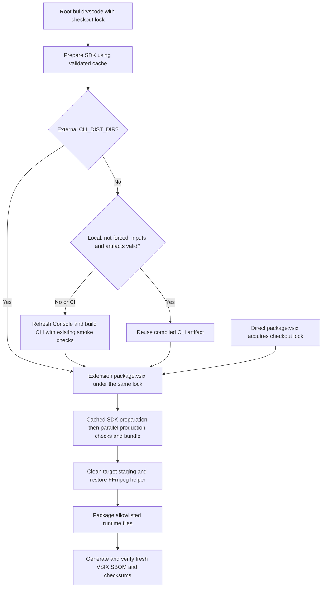

# Faster VSIX Builds - Plan

## Goal Capsule

- Objective: Reduce the time developers wait to install and test a newly packaged Dustcode extension, and reduce unnecessary release packaging work.
- Means: Limit packaged files, reuse verified build inputs, and parallelize independent checks (KTD1-KTD4).
- Constraints: Preserve extension functionality, typechecks, lint, compiled-backend smoke checks and VSIX SBOM evidence.
- Authority: Requirements govern behavior; technical decisions govern implementation within those requirements.
- Execution: Implement and verify locally. No commit, push, PR, or release publication is authorized.
- Stop conditions: Stop for a user decision if an optimization requires removing functionality or weakening release checks.

---

## Product Contract

### Summary

Optimize repeated local VSIX builds and release packaging without changing extension capabilities or weakening validation.

### Problem Frame

The supplied Windows build packages 2,997 files into a 194.79 MB VSIX, including 878 Storybook files totaling 39.41 MB uncompressed, tests, docs and development metadata.
The packaging script also bypasses existing SDK caching and runs independent validation tasks sequentially.
The root build always recompiles the CLI backend, and packaging deletes FFmpeg before its reuse check.
These costs lengthen the edit, package and install loop.
The log has no stage timings, so it does not establish which stage dominates elapsed time.

### Requirements

**Packaging**
- R1. Ship only extension runtime files, manifest assets, user-facing package information and required license notices.
- R2. Preserve the compiled CLI, console resources, tree-sitter WASMs, sandbox workers/helpers, Playwright runtime, fonts, webview chunks and notification audio required by the existing extension.

**Build behavior**
- R3. Repeated local builds reuse SDK, compiled backend and FFmpeg outputs only when relevant inputs and required artifacts remain valid; CI always compiles the locally managed backend afresh.
- R4. Changed backend inputs, build identity or incomplete outputs trigger a rebuild rather than silently packaging a stale binary or development wrapper.
- R5. Local and release builds retain existing checks and regenerate SBOM/checksum evidence for the actual VSIX produced on every run.
- R6. Keep the existing root `build:vscode`, package `package:vsix`, `--single` and prerelease workflows working; explicitly supplied `CLI_DIST_DIR` is consumed without an unnecessary local backend build.

### Confirmed Policy

Local backend reuse is enabled by default; CI compiles a new locally managed backend and runs existing build smoke checks even if a valid local cache record exists.
This was selected over allowing backend cache hits in CI.
SDK/FFmpeg reuse and parallel checks remain available in both environments.
All builds generate fresh VSIX evidence; a local distributable requiring a fresh backend uses `--force`.

### Success Criteria

- No Storybook, tests, test reports, development docs or build-cache files appear in the VSIX file listing.
- An unchanged local warm build with a fresh model snapshot performs no SDK generation, backend compilation or FFmpeg package extraction/download.
- On the same Windows machine and target, aim for at least 30% lower median end-to-end time across three warm runs versus the original pipeline. Report measured results rather than claiming this target without evidence.
- Record cold-build time, stage times, compressed size and file count before and after. Cold builds must not regress materially; investigate an observed regression greater than 10% rather than masking it with warm-run gains.

### Scope Boundaries

- Keep the full embedded CLI backend. VS Code-only distribution does not make the agent runtime optional.
- Do not remove console/browser support, model snapshots, language WASMs or third-party runtime files merely to suppress the VSCE bundling warning.
- Do not introduce skip-checks or skip-SBOM modes, a new backend architecture, or manual changes to SDK-generated source files. Normal SDK generation remains permitted during implementation verification.
- Do not add CI artifact fan-out or cross-run backend cache restoration in this change. Existing clean CI runners must still build and validate their own target.
- Defer a dedicated serve-only executable and targeted Playwright/console pruning until measurements justify their larger compatibility surface.

---

## Planning Contract

### Evidence

- `script/kilocode/build-vscode.ts` unconditionally builds the native CLI before invoking extension packaging.
- `packages/kilo-vscode/script/build.ts` removes `bin`, `dist` and `out`, unconditionally builds SDK, then sequentially typechecks host/webview, lints and bundles.
- `packages/kilo-vscode/script/prepare-sdk.ts` already fingerprints SDK inputs and generated sources, but only checks two compiled entrypoints for output readiness.
- `packages/kilo-vscode/package.json` already provides `build:check:production` to run independent checks and bundling in parallel.
- `packages/kilo-vscode/esbuild.js` already bundles the host/webviews, runs its build contexts concurrently and caches Solid transformations.
- `packages/kilo-vscode/script/playwright-runtime.js` deliberately copies external Playwright/chromium-bidi dependency trees into `dist/node_modules`.
- `packages/kilo-vscode/script/ffmpeg-helper.ts` checks for a destination binary before returning; deleting `bin` defeats that reuse.
- `packages/kilo-vscode/script/local-bin.ts` offers fingerprinting patterns, but is not a release artifact cache: it can create source wrappers, clears CLI dist on rebuild and does not preserve every packaging resource such as console assets.

### Key Technical Decisions

- KTD1. Use a default-deny `.vscodeignore` with explicit runtime/documentation inclusions that themselves do not match forbidden files. VSCE unions negated inclusions, so later exclusions cannot override `!bin/**` or `!dist/**`; do not use those unconditional patterns. Include known backend executables/helpers and resource trees, and compiled extension/webview/runtime paths with patterns that omit source maps and local markers. Keep manifest assets, audio, readme/changelog and notices. Preserve third-party runtime/license sources, including Linux `bin/licenses/bubblewrap/build.ts`; do not blanket-exclude `.ts` inside those trees. Verify the resulting list with actual VSCE, not gitignore semantics.
- KTD2. Prepare SDK before any consumer reads generated files, then call `build:check:production` instead of duplicating serial checks. Root and direct packaging use `prepare-sdk.ts`; the second preparation in root-to-package flow must be a cache hit. Retain the existing full SDK build on a miss rather than adding a second generation-only pipeline. SDK exports resolve to `src`, so compiled-dist readiness is build completeness, not evidence that extension imports use `dist`.
- KTD3. Add a local native-backend cache at the Kilo-owned root build boundary. Follow workspace traversal/fingerprint patterns in `local-bin.ts` but never call its wrapper fallback. Store one last-success record under `packages/kilo-vscode/node_modules/.cache/vsix-backend.json` referencing the native artifact in `packages/opencode/dist`; do not duplicate the large binary into a second cache. CI (`CI` truthy except `0`/`false`, or `GITHUB_ACTIONS=true`) and `--force` bypass backend reuse. Validate the actual Bun revision against the existing pin even on a hit.
- KTD4. Cache extracted FFmpeg under `packages/kilo-vscode/node_modules/.cache/ffmpeg`, separate from disposable target staging, keyed by exact package spec and target with a stored content digest. Replace the existing target-only destination shortcut so a package-spec change cannot retain an older helper. Retain clean target `bin` assembly. Restore by copying, not linking, so staging cleanup cannot modify cached bytes. Cache publication occurs only after successful extraction/validation; preserve the existing helper API used by local launch.
- KTD5. Record stage elapsed times and hit/miss reasons in existing script output. Measure the original baseline before functional edits, distinguishing cold build, unchanged local warm build and webview-only edit. No benchmark service or telemetry is needed.

### Backend Cache Contract

1. Compute identity after SDK preparation, from current working-tree content, including staged/unstaged edits, untracked nonignored inputs and deletions. Cover transitive CLI and Console build workspaces, root manifest/lockfile/patches, `packages/script`, root build wrapper, `script/kilocode/bun.ts` and `bun.json`, preparation scripts, generated SDK sources, platform/architecture and effective version/channel/prerelease settings. Exclude generated dist/cache/test-report directories. A webview-only edit must remain a hit.
2. Include output-affecting compiler/runtime settings such as `KILO_SKIP_BUNDLED_BWRAP`, `ZIG` and its compiler identity, `NIX_BUILD_TOP`, model URL and explicit snapshot contents. Cache storage paths alone are not build identity. Inventory the actual build dependencies when implementing; unknown/nonstandard build configurations should conservatively miss rather than reuse unchecked output.
3. When `MODELS_DEV_API_JSON` is set, hash that file and preserve existing failure behavior if it cannot be read. Otherwise require the normal model cache to exist, match the successful build digest and be younger than six hours. Missing, changed or expired snapshot means a miss. Let the existing CLI generator perform the refresh and offline fallback; do not introduce another fetcher or import its side-effectful script into the orchestrator.
4. On a miss, run the existing native CLI build and its smoke checks. Invalidate the Console `dist` before this rebuild so its separate mtime-only cache cannot hide older checkout timestamps or defeat `--force`. Keep the full Console functionality and upstream build command unchanged.
5. Record identity and the actual post-build model snapshot only after success. Verify non-generated source identity did not change during preparation/build; fail without publishing a success record if it did. Do not bless artifacts using a different pre-refresh snapshot fingerprint.
6. Validate a relative-path artifact inventory with content digests and executable permissions where applicable: native CLI, target package metadata, Console files, WASMs, sandbox worker, Linux network/seccomp helpers and license/source-offer files. Missing, altered or extra files invalidate reuse. This proves integrity relative to the local successful build, not remote provenance.

### Failure and Compatibility Rules

- Write cache records atomically after their own stage succeeds. A later lint, package or SBOM failure does not invalidate a correctly generated SDK/backend/helper; nevertheless the overall command fails and must not report a releasable package.
- Root recognizes only `--force` and `--help`; reject unknown options. `--force` rebuilds the local backend, not dependencies, SDK or every helper. With `CLI_DIST_DIR`, fail clearly if `--force` is also supplied rather than silently ignoring either intent.
- Resolve external `CLI_DIST_DIR` once relative to invocation cwd and pass its absolute path to packaging. Root skips local backend preparation in this mode; direct `package:vsix` continues to consume supplied prebuilt targets. External artifacts are caller-managed, not cache-certified; preserve existing resource checks and fresh VSIX/SBOM validation without claiming source equivalence.
- Use a checkout-local exclusive build lock covering SDK mutation and all shared output cleanup/assembly. Root owns it across backend and packaging; direct packaging and standalone SDK preparation participate without nested deadlock. Pass verifiable ownership to child steps rather than trusting an arbitrary boolean skip flag. A simultaneous invocation fails before cleanup with an actionable message. Release in `finally`; do not silently steal a stale lock. Concurrent local launch/watch builds remain unsupported and must be stopped before packaging; do not extend this change into the launch/watch pipeline.
- Keep `KILO_RELEASE` empty in the root wrapper. Do not invoke upstream archive creation or publication. Preserve current version/channel behavior rather than fixing unrelated prerelease policy here.
- Cache schema mismatch or invalid metadata is a logged miss. If git fingerprinting is unavailable, rebuild without caching. Readable valid cache is optional; source/build failures are not swallowed.
- Keep clean `bin`, `dist` and `out` assembly on each packaging run. No full-bundle/VSIX/SBOM cache in this change.
- Do not alter unrelated worktree edits. Tests must not clean shared project output while another build runs; use temporary fixture repos and artifact trees for invalidation cases.

### Build Flow

---

## Implementation Units

### U1. Restrict VSIX contents

**Goal:** Remove clearly non-runtime files without breaking packaged runtime resolution.
**Requirements:** R1, R2, R6.
**Files:** `packages/kilo-vscode/.vscodeignore`; extend `packages/kilo-vscode/tests/unit/esbuild-dependencies.test.ts`.
**Approach:** Implement KTD1. Extend the existing VSCE `listFiles` fixture rather than testing ignore patterns with a different matching implementation.
**Test scenarios:**
- A fixture containing Storybook output, tests, reports, docs and cache directories excludes them while keeping manifest assets, audio and notices.
- Keep compiled webview files, lazy Settings chunks/preload metadata, fonts, CLI resources and platform-appropriate helpers.
- Keep the existing packaged-browser test loading Playwright outside the repository, including generated JS and transitive dependency manifests.
- Exclude `.cli-version`, source maps and local helper markers, including a fixture where they sit beside required runtime files. Preserve Linux license/source-offer files and dynamic runtime JS; do not rely on exclusion ordering.
**Verification:** Inspect the real VSCE listing and unpacked VSIX, then smoke-test packaged extension/runtime assets.

### U2. Reuse SDK preparation and parallel checks

**Goal:** Remove repeated SDK work and serialization without skipping validation.
**Requirements:** R3, R5, R6.
**Dependencies:** None; integrate before U3.
**Files:** `packages/kilo-vscode/script/build.ts`, `packages/kilo-vscode/script/prepare-sdk.ts`, `script/kilocode/build-vscode.ts`; new `packages/kilo-vscode/script/build-lock.ts` and `packages/kilo-vscode/tests/unit/prepare-sdk.test.ts`.
**Approach:** Implement KTD2. Complete SDK preparation before backend/bundle consumers. Strengthen readiness of compiled SDK outputs and include relevant toolchain inputs so a damaged SDK dist cannot count as a hit. Keep helpers small and test real fingerprint/validation behavior with temporary fixtures.
**Test scenarios:**
- Unchanged inputs and complete generated/compiled outputs reuse preparation.
- Changed API source, generated output, dependency/toolchain input, untracked source or deleted compiled output causes a miss.
- SDK failure publishes no SDK success record; downstream validation failure prevents packaging but may retain successfully prepared inputs.
- Root invocation followed by packaging does not generate SDK twice; direct packaging still prepares SDK itself.
- A second build in the same checkout fails before deleting outputs; root-to-package ownership does not deadlock; a failed build releases the lock.
**Verification:** Production typecheck, lint and bundle all run, with SDK prepared before consumption.

### U3. Cache verified compiled backend artifacts

**Goal:** Avoid rebuilding the CLI for extension-only changes.
**Requirements:** R3-R6.
**Dependencies:** U2.
**Files:** `script/kilocode/build-vscode.ts`; new `packages/kilo-vscode/script/prepare-backend.ts` and `packages/kilo-vscode/tests/unit/prepare-backend.test.ts`.
**Approach:** Implement KTD3 and the failure/compatibility rules. Keep the upstream CLI build command and its smoke checks unchanged on misses. Prefer narrow testable helpers in the preparation script over a generic build framework.
**Test scenarios:**
- Same source/build identity and verified artifact inventory yields a local hit; a webview-only edit does not invalidate the backend. CI still executes a fresh build with a valid record present.
- Backend/transitive dependency, console, lockfile, patch, generated SDK, build script, Bun pin/revision, version/channel, platform or model snapshot change yields a miss.
- Missing/corrupt/extra runtime artifacts, invalid metadata, stale remote-model freshness or force-rebuild yield a miss.
- At six-hour expiry, generator refresh may change snapshot bytes; the next unchanged run hits using the post-refresh digest. Offline fallback preserves existing generator behavior and does not falsely mark old snapshot data fresh.
- `--force` and a source change with older Console mtimes still rebuild Console; wrong active Bun revision fails before a cache hit.
- Failed backend build/smoke check fails packaging and leaves no reusable success record.
- Relative external CLI dist resolves from invocation cwd, skips the local build and is preserved. Combining it with `--force` fails clearly; a development wrapper is never accepted by the local compiled cache.
**Verification:** A native build still reports the expected version and starts its authenticated server; packaged sandbox workers and tree-sitter resources remain available outside the repo.

### U4. Cache FFmpeg and measure the complete pipeline

**Goal:** Avoid helper preparation on warm runs and establish actual performance gains.
**Requirements:** R2, R3, R5, R6.
**Dependencies:** U1-U3 for final measurement.
**Files:** `packages/kilo-vscode/script/ffmpeg-helper.ts`, `packages/kilo-vscode/script/build.ts`, `script/kilocode/build-vscode.ts`; new `packages/kilo-vscode/tests/unit/ffmpeg-cache.test.ts`; a patch changeset for `dustcode` when implementing the smaller package/build improvement.
**Approach:** Implement KTD4-KTD5. Preserve exact per-target FFmpeg specs and the intentional Windows ARM64 fallback. Keep SBOM generation tied to each newly packaged artifact rather than caching evidence.
**Test scenarios:**
- Valid exact-spec cache restores into freshly emptied `bin` without npm/extraction.
- Wrong target/spec, missing/corrupt binary or failed extraction cannot produce a valid helper cache entry.
- Switching target leaves no previous-platform helper in the package; Windows ARM64 retains its documented fallback.
- Every new VSIX has newly verified matching SBOM, checksum and artifact manifest data.
**Verification:** Compare cold and warm measurements, inspect final VSIX contents and run the package/runtime smoke checks.

### Execution Order

1. Capture the untouched baseline, including the second/third root build where SDK-generated files have stabilized.
2. Implement U1 and U2; prove the VSCE inclusion list and SDK/check ordering before introducing backend reuse.
3. Implement U3 and U4 using real temporary input/artifact fixtures; keep heavyweight builds out of unit-test failure matrices.
4. Run native end-to-end builds and package smoke checks. Keep CI matrix/workflow configuration unchanged; validate other platforms when their runners are available.
5. Roll out local reuse by default only after invalidation tests pass. Rollback is removal/invalidation of the local cache record or using `--force`; no user-data migration is involved.

---

## Verification Contract

- Before functional edits, measure the original pipeline on Windows x64: one cold and three repeated builds, identical pinned model snapshot, target, Bun revision and validation/SBOM settings. Preserve logs and file listings outside output directories. Stage timing instrumentation may precede functional changes; do not invent stage times from the supplied log.
- Define cold as missing disposable SDK dist/backend/Console/extension outputs and new optimization caches, but retain tracked SDK source, installed dependencies and pinned tool downloads. Define warm as unchanged successful inputs, locally reusable backend, model snapshot still fresh, and outputs rebuilt by normal packaging cleanup. Compare cold to cold and median warm to median warm. Never delete tracked sources or unrelated developer artifacts to create the baseline.
- After implementation, repeat the same samples. Also measure a webview-only edit and a backend edit. Test model expiry separately with controlled fixture clocks/data, not by waiting six hours or editing the developer's real cache.
- From `packages/kilo-vscode/`: run targeted new tests and `bun test tests/unit/esbuild-dependencies.test.ts`, then `bun run typecheck`, `bun run lint`, `bun run test:unit`, `bun run knip` and `bun run check-kilocode-change`.
- From the root: run `bun run lint`, `bun test ./script/kilocode/vscode-ci.test.ts`, and `bun run build:vscode` for the end-to-end native VSIX. Do not run root `bun test` without a target.
- Inspect `vsce ls --tree` and the real VSIX ZIP. Verify expected resources and zero dev-only directories; do not impose an arbitrary total-file cap because external runtime trees remain intentional.
- Test from an unpacked package outside the repo: backend version/server startup, sandbox worker, tree-sitter lookup and Playwright module loading. Verify all webview entrypoints, worker URLs and Settings preload references resolve.
- Keep existing SBOM policy/manifest verification enabled. Check cold CI packaging on Linux/macOS/Windows using existing workflows; do not claim locally untested platforms passed.
- Run formatting checks on touched scripts and tests. Extension `typecheck` covers only `src`, not `script`; targeted tests must import and execute the actual preparation helpers rather than duplicating cache logic. Use real filesystem/git fixtures and small child commands where orchestration needs observation; do not mock the SDK/backend implementation.
- If implementation unexpectedly needs shared opencode changes, minimize/annotate them and run affected guards. They are not expected; invalidate Console output from the Kilo-owned orchestrator rather than modifying the upstream build.

---

## Definition of Done

- R1-R6 hold, regression tests pass and measurements meet the success criteria or explicitly document the remaining performance shortfall.
- The actual VSIX excludes development artifacts while preserving runtime smoke checks and valid fresh SBOM evidence.
- No unchecked stale binary reuse, wrapper fallback, target contamination or generated-source race is introduced.
- Unrelated worktree changes and upstream backend behavior remain intact; abandoned experiments are removed.
- Final report distinguishes measured gains from targets and states any platform/check not exercised.
